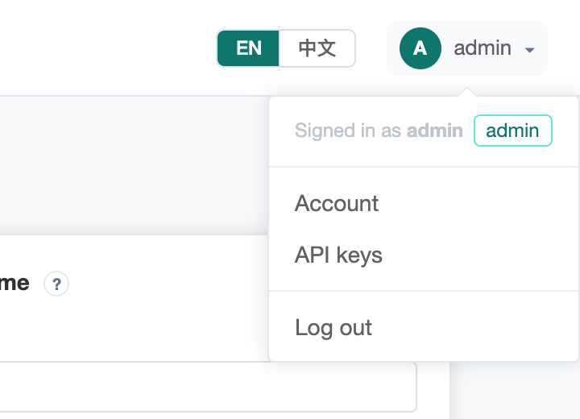
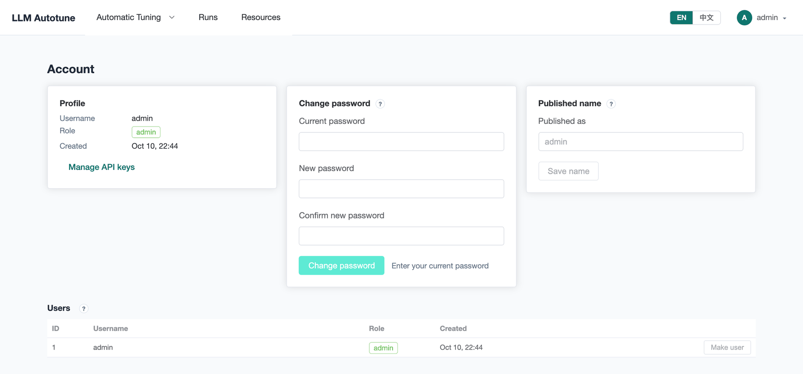
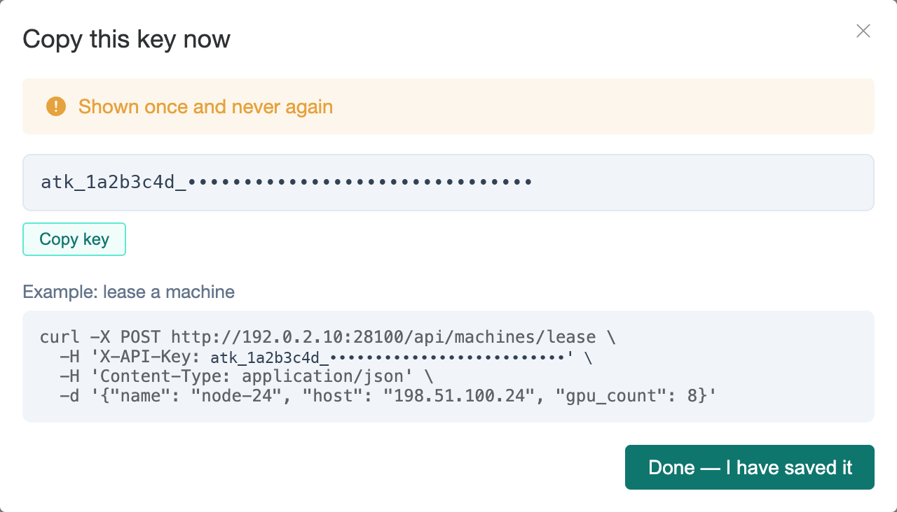
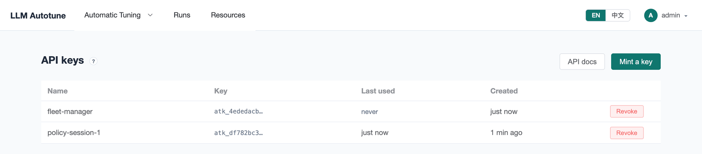

[User guide](README.md) › **Account, users and API keys**

# Account, users and API keys

Your user menu, top right, has **Account** and **API keys**, and the language
switch next to it changes the interface between English and 中文.



## Users and roles

The install creates one user, `admin`, with the password it prints. Anyone who
can open the UI can also **Create account** on the sign-in page; new accounts
are ordinary *users*.

- **Admins** can also add and edit GPU clusters, register their nodes, and
  manage users.
- **Users** can do everything else: lease machines, build search spaces and
  objectives, create and run campaigns, and mint their own API keys.

The **Users** list at the bottom of the **Account** page (admins only) makes
another user an admin, or an admin a user again. The last admin can't be
demoted.

## Your account



- **Profile**: your username, role, and when the account was made.
- **Change password**: at least 6 characters. You stay signed in, and your API
  keys keep working.
- **Published name**: the name your benchmark submissions appear under on
  LLMBench. It defaults to your username.

## API keys

Scripts and other systems use the platform's API with an **API key** instead of
a password. A key acts with the authority of the user who minted it, and
appears in the platform's records as `key:<name>`.

Open **API keys** from the user menu and press **Mint a key**. Give it a name
that says who uses it, such as `fleet-manager`.



The key is shown **once**. Copy it then: only a hash is stored, so a lost key
is replaced, not recovered. The dialog includes an example call; the address
in it is a placeholder for your platform's.

Send the key in the `X-API-Key` header:

```bash
curl http://localhost:8080/api/campaigns -H "X-API-Key: $KEY"
```

The list shows each key's name, its first characters, and when it was last
used. **Revoke** stops a key at once.



**API docs** opens the interactive reference of every endpoint. The ones made
for other systems are described in:

- [Machine lease API](../api/machine-lease.md): lending machines to the
  platform from a scheduler, and taking them back;
- [Policy API](../api/policy-api.md): what a search policy calls;
- [Agent API](../api/agent-api.md): the read-only data LLM-written performance
  reports are built from (off by default).

---

← [Runs and failures](runs.md) · [User guide](README.md) · Next: [Troubleshooting](troubleshooting.md) →
