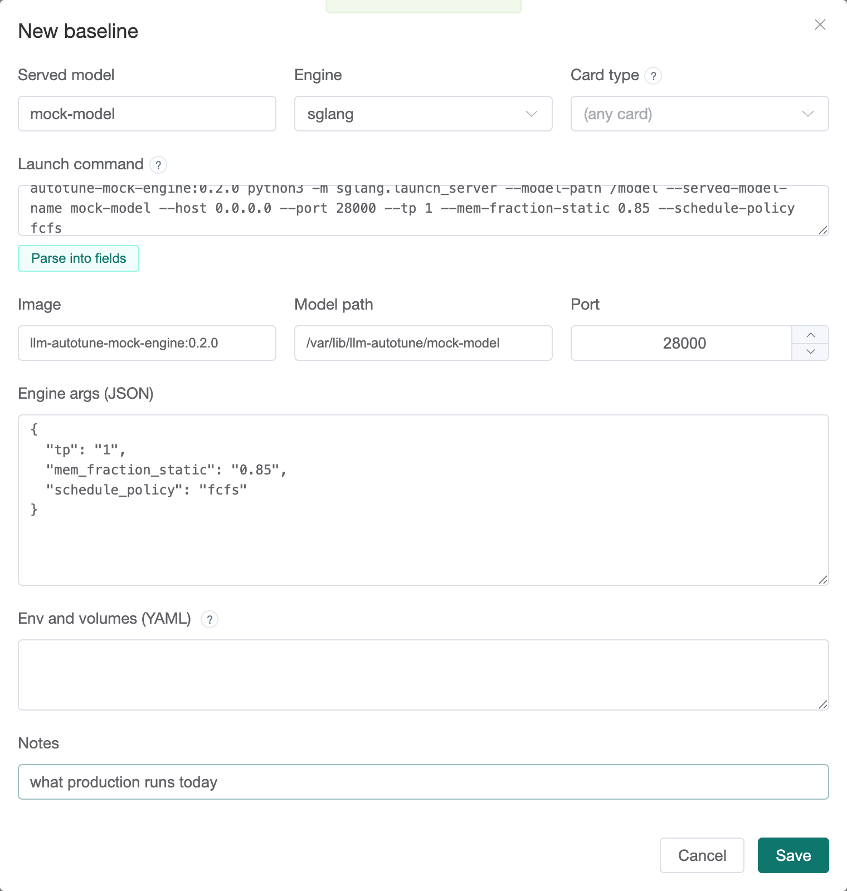
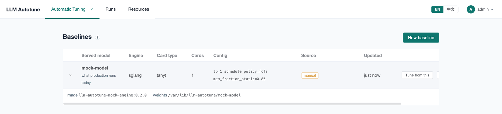

[User guide](README.md) › **Baselines**

# Baselines

A **baseline** is the config production runs today for one model, on one
engine and one type of card: the image, the weights path, the port, the engine
settings, the environment and the mounts. Find them under
**Automatic Tuning ▸ Baselines**.

Recording one is optional, but it turns a campaign's numbers into an answer.
"746,429 tokens per minute per GPU" means little on its own; "+12% over
production, measured the same way on the same night" is a decision.

## What a baseline does

When a campaign tunes a model that has a baseline (the same **served model
name** and **engine**, on the same **card type**, or any card if the baseline
names none):

- **The campaign measures production too.** It starts the baseline's config on
  one of its own machines, as one more run, and benchmarks it exactly like the
  candidates. On the leaderboard it is the row tagged **baseline**.
- **Every result is shown against it**, in the **vs baseline** column.
- **The Check step compares the campaign with it** (**Matches production**),
  and the **Configuration** tab lists flags production sets that the campaign
  never does (**Difference from production**).
- **It can draft a campaign**: **Tune from this**.

## Recording one

Press **New baseline**. The quickest way is to paste production's launch
command into **Launch command**, either the whole `docker run …` line or just
the serve command, and press **Parse into fields**.

The parse fills in:

- **Image**, **Model path** and **Port**;
- **Engine args**: every engine flag, as JSON;
- **Env and volumes**: environment variables and mounts, as YAML.

Flags that only place the engine (the model path inside the container, the
host, the served name) are dropped, because every run sets those itself.

Then check the top row:

- **Served model**: the name the model is served under. Campaigns are matched
  to the baseline by it, so use the same name in campaigns (by default a
  campaign's served name is the last part of its model path).
- **Engine**: `sglang` or `vllm`.
- **Card type**: the GPU model, such as `H100`. A baseline is only compared with
  runs on the same card; leave it empty to match any card.

Press **Save**.

> **Port:** an engine port between 30000 and 32767 earns a warning. On
> Kubernetes nodes that range belongs to NodePorts, and an engine there can't be
> reached. Campaigns use their own ports anyway, from 28200 by default.

## The list

Each row shows the served model, engine, card type, card count and the main
engine settings. Expand a row for the image, the weights path and the
environment. **Source** says where it came from (*manual* for one entered on
this page). **Edit** and **Delete** do what they say; campaigns that already
measured it keep their numbers.

## Tune from this

**Tune from this** opens New campaign with a draft made from the baseline:

- its image, model path and engine settings, the settings becoming the fixed
  part of the search space;
- `tp` swept around production's value, as wide as your machines allow;
- the platform's default benchmark, objective and window.

The wizard opens on the **Check** step, with a note listing where each value
came from:

Review the steps (the benchmark and the search space especially),
then **Create campaign**. **Start from a baseline** on New campaign does the
same, and can also draft from just a model name.

After a campaign finds a better config and you roll it out, **Edit** the
baseline to match, so the next campaign measures against the new production.

---

← [Reading results](results.md) · [User guide](README.md) · Next: [Runs and failures](runs.md) →
