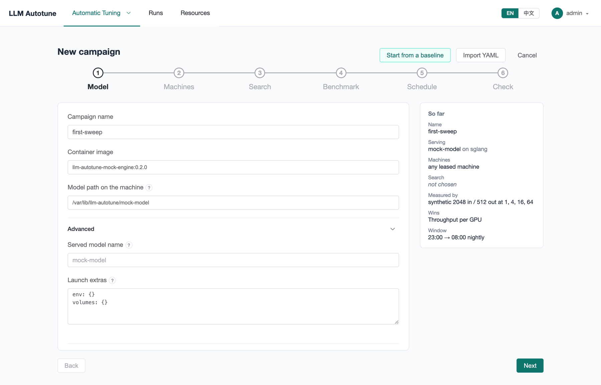
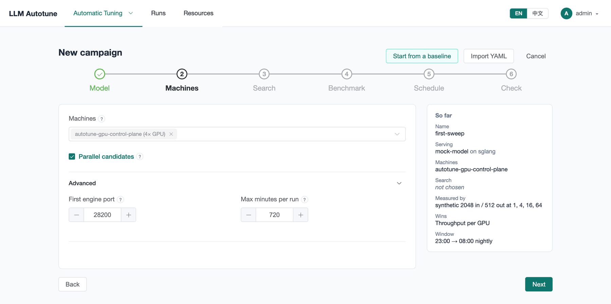
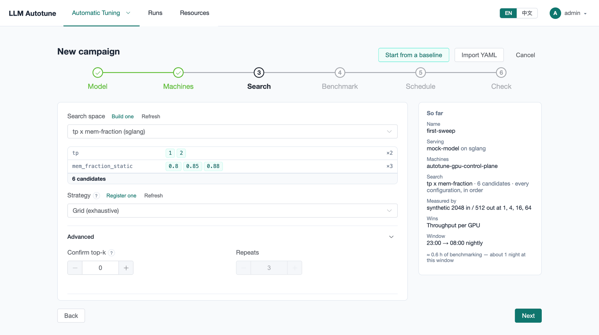
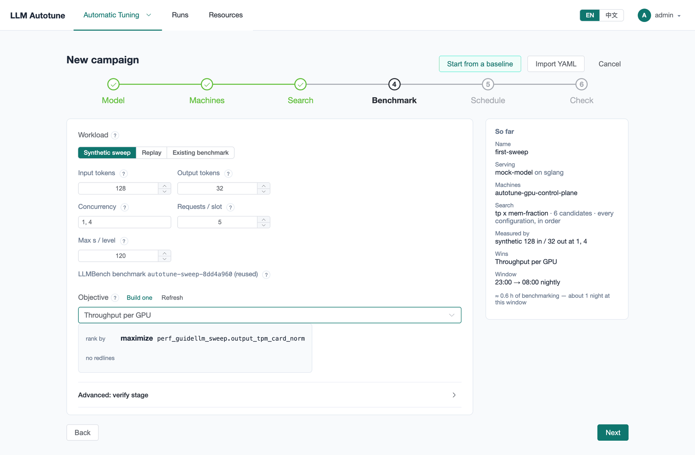
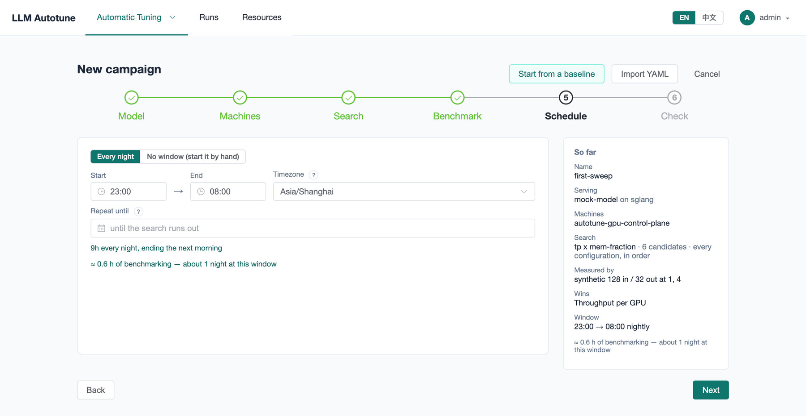
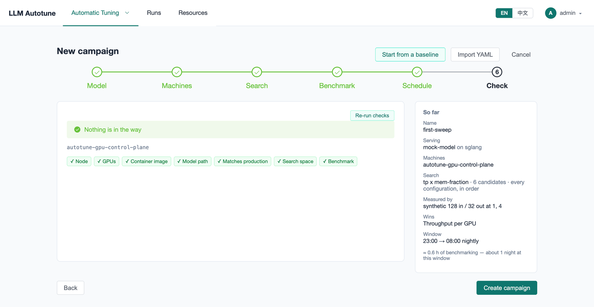
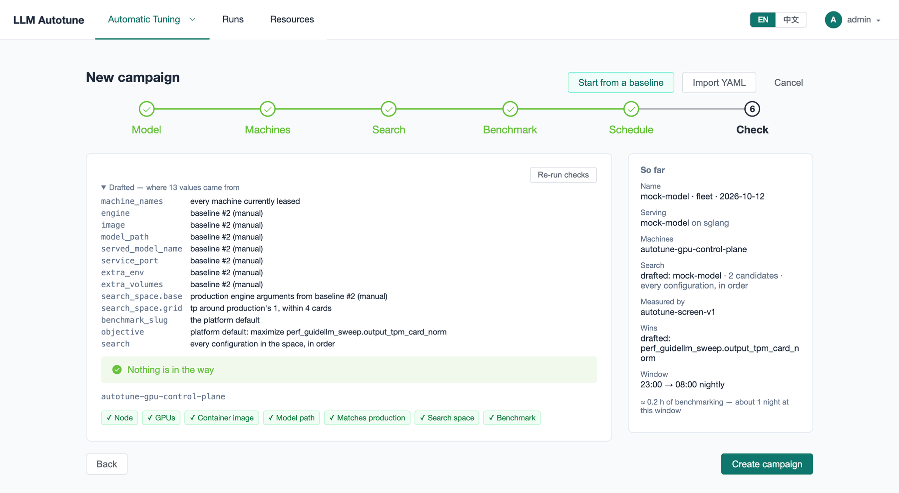

[User guide](README.md) › **Creating a campaign**

# Creating a campaign

A **campaign** is one search: which model and engine image to run, on which
machines, over which search space, measured with which workload, ranked by
which objective, and when it may run. Press **New campaign** on
**Automatic Tuning ▸ Campaigns**.

There are three ways to start:

- **Fill in the wizard** step by step (below).
- **Start from a baseline**: the platform drafts the whole campaign from a
  recorded production config ([below](#starting-from-a-baseline)).
- **Import YAML**: paste a campaign exported from another one
  ([below](#exporting-and-importing)).

The **So far** panel on the right sums up the campaign as you go, with an
estimate of how many hours of benchmarking it needs and how many nights that
is at its window. Click any step's title to go back to it; **needs …** next
to **Next** says what a step is still missing.

## 1. Model



- **Campaign name.** Defaults to one made from the model.
- **Container image.** The engine image every run starts, such as
  `lmsysorg/sglang:<version>`. The engine itself (sglang or vLLM) comes from the
  search space you pick on step 3.
- **Model path on the machine.** The folder with the weights on the GPU node or
  ssh machine. It is mounted into the container as `/model`. On Kubernetes the
  weights must be at this path on every machine the campaign uses.

**Advanced:**

- **Served model name**: the name the engine answers to. Only the platform
  and LLMBench use it; by default it is the last part of the model path.
- **Launch extras**: environment variables and extra mounts every run's
  container gets, as YAML:

  ```yaml
  env:
    HF_HUB_OFFLINE: "1"
  volumes:
    /data/cache: /root/.cache
  ```

## 2. Machines



- **Machines.** The leased machines the campaign may use. Pick the ones that
  have the model's weights. Left empty, any leased machine will do.
- **Parallel candidates.** On by default: several candidates share a machine at
  once, each on its own GPUs. An 8-GPU machine testing `tp=2` configs runs four
  at a time. Turn it off if configs might disturb each other through the host
  (CPU, memory bandwidth).
- **Node group** (only if you have one): spread each run across a group's
  machines, for a model that needs several nodes ([node groups](machines.md#node-groups-multi-node)).

**Advanced:**

- **First engine port**: runs take the first free port from here (28200 by
  default). Ports 30000–32767 are skipped, because Kubernetes reserves them
  for NodePorts.
- **Max minutes per run**: a safety limit for one run. The window is planned
  from how long this campaign's runs actually take; this is only the ceiling.

## 3. Search



- **Search space.** Pick a saved one; the map below shows its parameters and
  candidate count. **Build one** opens the Search spaces page in a new tab, and
  **Refresh** reloads the list when you come back.
- **Strategy.** **Grid (exhaustive)** tries every candidate, in order. A policy
  picks for you ([Search policies](policies.md)).
- **Finalists** (policies only): how many of its best configs the policy names
  at the end for the platform to measure again.

**Advanced** (grid only):

- **Confirm top-k** and **Repeats**: before finishing, run the best *k* configs
  again, *Repeats* times each. One measurement can lead by luck; several
  measurements show how much a result varies. 0 turns it off.

## 4. Benchmark



**Workload** is the load each candidate gets. You describe it, and the line
underneath names the benchmark AutoTune creates for it on LLMBench, *new* or
*reused*. The same workload always maps to the same benchmark, so campaigns
that share one can be compared.

- **Synthetic sweep.** Random prompts:
  - **Input tokens** and **Output tokens**: the length of each prompt and of
    each answer.
  - **Concurrency**: the load levels, run one after another, such as
    `1, 4, 16, 64`.
  - **Requests / slot**: level *c* sends *c* × this many requests. More means
    steadier numbers and longer runs.
  - **Max s / level**: a level that hasn't finished by then stops anyway.
- **Replay.** Recorded production traffic, sent again. Pick a **Dataset** set up
  on LLMBench (without one, a 20-request example set proves the pipeline but
  measures nothing), how many **Requests** to send (0 for all) and at what
  **Concurrency**. **Resample at start** takes a fresh sample of a rolling
  dataset when the campaign starts. Every candidate then sees the same sample.
- **Existing benchmark.** Name an LLMBench benchmark by its slug.

**Objective** is what ranks the candidates. Only objectives this workload can
report are listed ([Objectives](objectives.md)); **Build one** opens the
Objectives page.

**Advanced: verify stage.** Screen every candidate with the workload above, then
measure only the best few again with a second, more realistic workload (usually
a replay), and let that second measurement decide. A replay can take most of an
hour per config, so this saves a lot of time on a big space. Set the second
workload, how many to verify (**Top-k**) and its objective.

## 5. Schedule



- **Start** and **End**: the window, every night, such as 23:00 → 08:00.
  Pick the **Timezone** it is meant in; 23:00 stays 23:00 across a
  daylight-saving change.
- **Repeat until**: optional. After this date no new night starts and the
  campaign finishes.

The line underneath restates the window and estimates how many nights the
search needs. Runs that could not finish before the window ends are not
started, and a search continues the next night where it stopped.

**No window:** clear both times. The campaign then runs only when you start
it, until its search is done or you stop it.

## 6. Check



**Run checks** looks for what would stop the campaign, machine by machine:

- the machine (a cluster node, or an ssh box) answers and is ready, with
  enough GPUs for the widest candidate;
- the engine image can be pulled and the model path exists. On Kubernetes a
  probe pod on each machine actually pulls the image and mounts the path; it
  asks for no GPUs and is deleted afterwards;
- the policy image can be pulled, for a policy campaign;
- on an ssh machine, that the engine port is free;
- the search space and the benchmark are usable.

Passed checks are green chips. A problem gets its own line with what to fix,
and a warning (yellow) is worth reading but won't stop anything.
**Matches production** compares the campaign with a recorded baseline for the
same model: a flag production sets that the campaign never does is worth a
look.

**Create campaign** saves it. You land on its page; what happens next is
[Running a campaign](running-campaigns.md).

## Starting from a baseline

If production's config is recorded on [Baselines](baselines.md), **Tune from
this** there (or **Start from a baseline** here) drafts the whole campaign:

- the image, model path and engine settings come from the baseline. Its
  settings become the fixed part of the search space;
- the search space sweeps `tp` around production's value, within the cards
  your machines have;
- the benchmark, objective and window are the platform's defaults.

The wizard opens on **Check**, with a note listing where each value came from.
Change anything, then create it as usual.



## Exporting and importing

On a campaign's page, **⋯ ▸ Export YAML** gives everything needed to recreate
it: model, machines, search space, workload, objective and schedule, without
its status or results. **Import YAML** on New campaign fills the wizard from
such a file and runs the checks. **⋯ ▸ Clone** does both in one step, under a
new name.

---

← [Search policies](policies.md) · [User guide](README.md) · Next: [Running a campaign](running-campaigns.md) →
