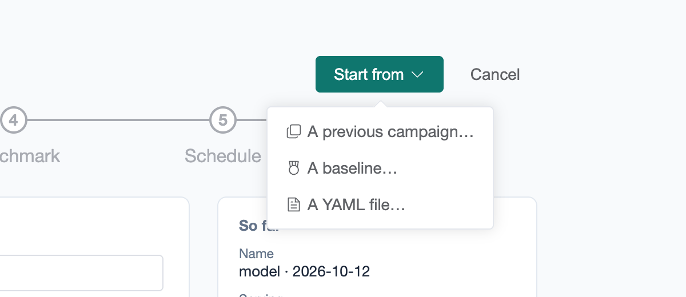

[User guide](README.md) › **Creating a campaign**

# Creating a campaign

A **campaign** is one search: the model and engine image, the machines, the
search space, the workload, the objective, and the schedule. Press **New
campaign** on **Campaigns**.

Fill in the wizard step by step (below), or start from something that
exists with **Start from**:

- **A previous campaign**: its definition fills the wizard in, under the
  next version of its name, to change before creating
  ([below](#exporting-and-importing)).
- **A baseline**: the platform drafts the whole campaign from a recorded
  production config ([below](#starting-from-a-baseline)).
- **A YAML file**: paste a campaign exported from another one
  ([below](#exporting-and-importing)).



The **So far** panel on the right summarizes the campaign, with an estimate
of the benchmarking hours it needs and how many windows that takes. Click a
step title to return to it; **needs …** next to **Next** lists what the step
is missing.

## 1. Model


- **Campaign name.** Defaults to one made from the model.
- **Container image.** The engine image every run starts, such as
  `lmsysorg/sglang:<version>`. The engine itself (sglang or vLLM) comes from the
  search space you pick on step 3.
- **Model path on the machine.** The weights folder on the GPU node or ssh
  machine, mounted into the container at `/model`. On Kubernetes the weights
  must be at this path on every machine the campaign uses.

**Advanced:**

- **Served model name**: the model name the engine serves under, used by the
  platform and LLMBench. Defaults to the last component of the model path.
- **Launch extras**: environment variables and extra mounts every run's
  container gets, as YAML:

  ```yaml
  env:
    HF_HUB_OFFLINE: "1"
  volumes:
    /data/cache: /root/.cache
  ```

## 2. Machines


- **Machines.** The leased machines the campaign may use: the ones that hold
  the model's weights. Empty allows any leased machine.
- **Parallel candidates.** On by default: several candidates share a machine,
  each on its own GPUs. An 8-GPU machine testing `tp=2` configs runs four at a
  time. Turn it off if configs could interfere through the host (CPU, memory
  bandwidth).
- **Node group** (shown when one exists): spread each run across a group's
  machines, for a model that needs several nodes ([node groups](machines.md#node-groups-multi-node)).

**Advanced:**

- **First engine port**: runs use the first free port from this one (28200
  by default). Ports 30000–32767 are skipped because Kubernetes reserves them
  for NodePorts.
- **Max minutes per run**: an upper limit for one run. Scheduling uses how long
  the campaign's runs actually take; this is only the ceiling.

## 3. Search


- **Search space.** A saved search space; the map below shows its parameters
  and candidate count. **Build one** opens the Search spaces page in a new
  tab, and **Refresh** reloads the list.
- **Strategy.** **Grid (exhaustive)** tries every candidate, in order; a
  policy chooses candidates ([Search policies](policies.md)).
- **Finalists** (policies only): how many of its best configs the policy names
  at the end for the platform to measure again.

**Advanced** (grid only):

- **Confirm top-k** and **Repeats**: before finishing, run the best *k*
  configs again, *Repeats* times each, to show how much a result varies.
  0 turns it off.

## 4. Benchmark


**Workload** is the load each candidate receives. The line below it names the
LLMBench benchmark AutoTune creates for it, *new* or *reused*. The same
workload always maps to the same benchmark, so campaigns that share one can be
compared.

- **Synthetic sweep.** Random prompts:
  - **Input tokens** and **Output tokens**: the length of each prompt and of
    each response.
  - **Concurrency**: the load levels, run in turn, such as `1, 4, 16, 64`.
  - **Requests / slot**: level *c* sends *c* × this many requests. More gives
    steadier numbers and longer runs.
  - **Max s / level**: a time limit for each level.
- **Replay.** Recorded production traffic, sent again. Select a **Dataset**
  ([Datasets](datasets.md); **New dataset…** at the bottom of the list sets
  one up), the number of **Requests** (0 for all) and the **Concurrency**.
  The 20-request example set only exercises the pipeline.
  **Resample at start** takes a fresh sample of a rolling dataset when the
  campaign starts; every candidate then receives the same sample.
- **Existing benchmark.** An LLMBench benchmark, by its slug.

**Objective** ranks the candidates. Only objectives whose metrics this
workload reports are listed ([Objectives](objectives.md)); **Build one** opens
the Objectives page.

**Advanced: verify stage.** Screen every candidate with the workload above,
then measure only the best few again with a second, more realistic workload
(usually a replay); the second measurement decides. A replay can take most of
an hour per config, so this saves time on a large space. Set the second
workload, the number to verify (**Top-k**) and its objective.

## 5. Schedule


- **Every night**: **Start** and **End** of the window, such as 23:00 →
  08:00, in the selected **Timezone** (23:00 stays 23:00 across a
  daylight-saving change). **Repeat until** (optional): after this date no new
  window starts and the campaign finishes.
- **No window (start it by hand)**: the campaign runs only when started, until
  its search is done or it is stopped.

The line below restates the window and estimates how many windows the search
needs. Runs that cannot finish before the window ends are not started, and a
search continues in the next window where it stopped.

## 6. Check


**Run checks** looks for anything that would stop the campaign, machine by
machine:

- the machine (a cluster node or an ssh machine) responds and is ready, with
  enough GPUs for the widest candidate;
- the engine image can be pulled and the model path exists. On Kubernetes,
  two probe pods on each machine pull the images and mount the path
  separately, so a wrong image and a wrong path are both reported in one run.
  They request no GPUs and are deleted afterwards;
- for a policy campaign, the policy image can be pulled;
- on an ssh machine, the engine port is free;
- the search space and the benchmark are usable.

Passed checks are shown as green chips. A failure gets its own line with the
fix; a warning (yellow) does not block the campaign. **Matches production**
compares the campaign with a recorded baseline for the same model and lists
flags production sets that the campaign does not.

**Create campaign** saves the campaign and opens its page; see
[Running a campaign](running-campaigns.md). If a check failed, it asks for
confirmation first.

## Starting from a baseline

If production's config is recorded on [Baselines](baselines.md), **Tune from
this** there (or **Start from ▸ A baseline** here) drafts the whole campaign:

- the image, model path and engine settings come from the baseline; its
  settings become the fixed part of the search space;
- the search space sweeps `tp` around production's value, within the GPUs the
  machines have;
- the benchmark, objective (**Throughput per GPU**) and window are the
  platform defaults.

The wizard opens on **Check**, with a note listing the source of each value.
Adjust anything, then create it as usual.


## Exporting and importing

On a campaign's page, **⋯ ▸ Export YAML** exports everything needed to
recreate it (model, machines, search space, workload, objective and schedule),
without status or results. **Start from ▸ A YAML file** on New campaign
fills the wizard from such a file and runs the checks.

**Start from ▸ A previous campaign** (or **⋯ ▸ Copy to a new campaign** on its
page) fills the wizard in from a campaign on this platform and stays on the
first step, to change what the next search needs. The search space and
objective are the ones that campaign ran with, even if the saved ones have
been edited since.

---

← [Search policies](policies.md) · [User guide](README.md) · Next: [Running a campaign](running-campaigns.md) →
