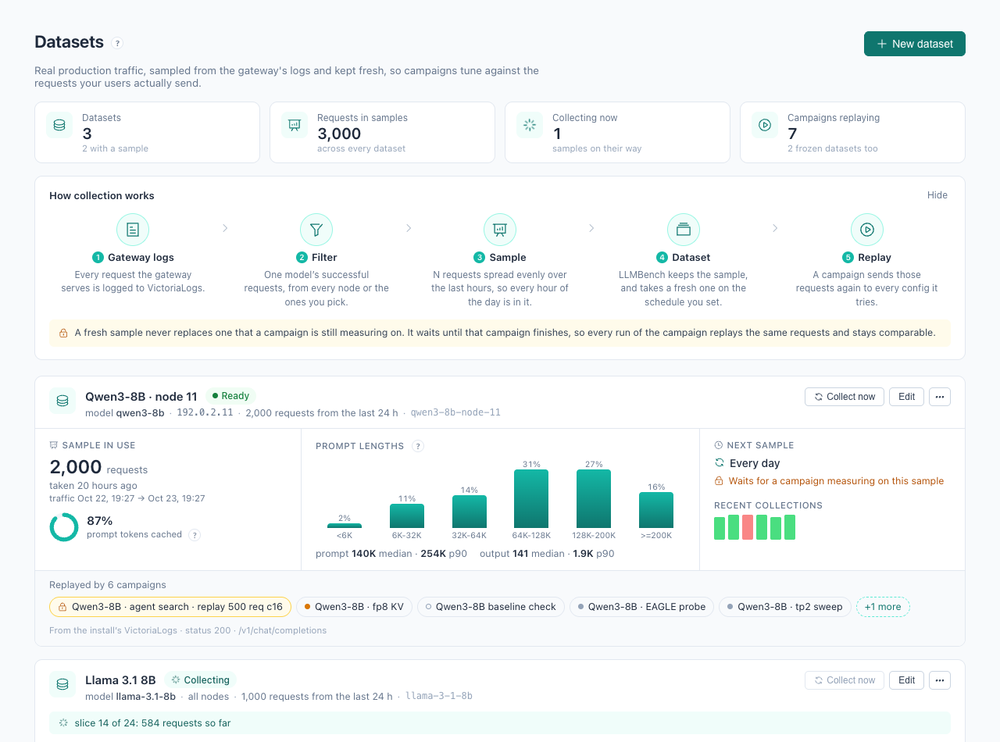
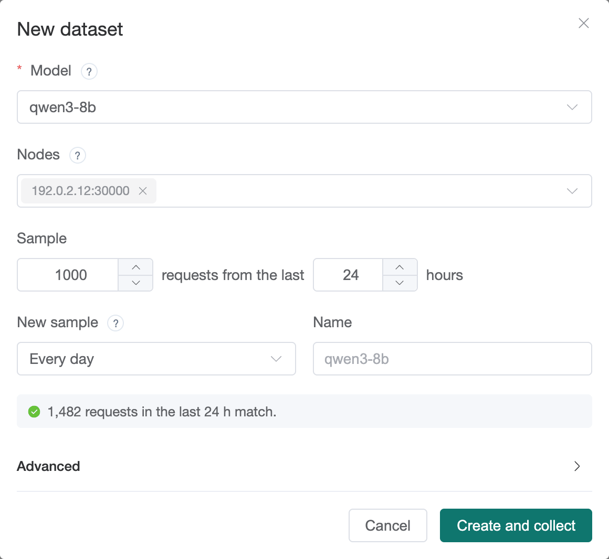
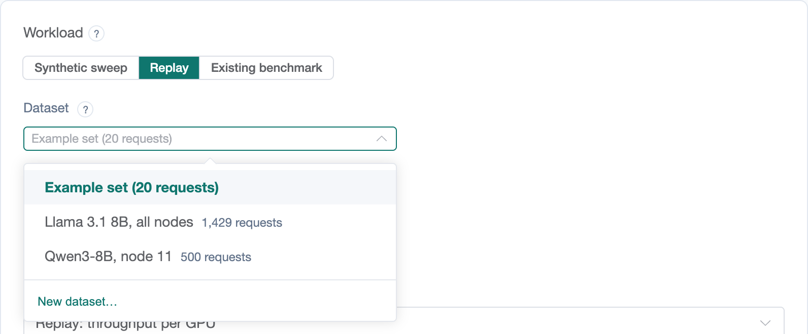

[User guide](README.md) › **Datasets**

# Datasets

A **Replay** workload sends each candidate recorded production requests
instead of random prompts, so the measurement reflects real prompt lengths
and prefix-cache reuse. The requests come from a **dataset**: a sample of one
model's traffic that LLMBench collects from the gateway's request logs in
VictoriaLogs. **Automatic Tuning ▸ Datasets** sets datasets up and shows what
each sample holds.

## Requirements

- A **VictoriaLogs** store of the gateway's request logs, reachable from
  LLMBench's pods.
- **LLMBench's dataset collector**, which is off by default.

Installing with `VICTORIALOGS_URL` set turns on the collector and gives the
form its default address
([After installing](../after-installing.md#replay-datasets)). Without a
collector, the page shows a warning and no sample can be collected.

## New dataset

Press **New dataset**.

- **Model**: the model name clients send. The list shows the models in the
  last day of traffic with their request counts; another name can be typed.
- **Nodes** (optional): only requests these backends served, as an IP (any
  port on it) or `IP:port`. The list shows the backends serving the chosen
  model. Empty takes the model's traffic from every node.
- **Sample**: how many requests, taken from the most recent hours. The window
  is split into hourly slices and each slice gets an equal share of the
  sample.
- **New sample**: how often a fresh sample replaces the current one: every 6,
  12 or 24 hours, every week, or only when asked.
- **Name** (optional): the name shown in lists. Defaults to the model.

Below the fields, the form shows how many requests in the last 24 hours match.
*No request matches* usually means a misspelled model or node.

**Create and collect** saves the dataset and starts collecting its first
sample, which takes seconds to minutes.

**Advanced** holds settings most datasets do not need:

| setting | default | when to change it |
|---|---|---|
| **VictoriaLogs address** | the install's | a dataset from another store |
| **Status codes** | `200` | to include other outcomes |
| **Paths** | `/v1/chat/completions` | another API path |
| **Extra LogsQL filter** | none | a filter the fields cannot express, such as `req_headers.x-app:="chat"` |
| **Longest prompt, tokens** | 262144 | the context length of the engines that will replay it |
| **Fewest requests** | 100 | a sample with fewer is not published; the previous one stays |
| **Slice, minutes** and **Busy-slice cap** | 60 and 4 | traffic in bursts: a quiet slice's unused share carries forward up to the cap, so raise it or widen the slices |
| **Samples kept** | 7 | older samples are deleted from LLMBench's volume |
| **Timezone** | UTC | the clock that slices longer than an hour align to |
| **ID** | from the name | the dataset's name on LLMBench, which cannot be changed later |

## The list

- **Current sample**: the request count and when it was taken; *Collecting…*
  while a new sample is being collected; the error if the last attempt
  failed.
- **New sample**: the interval and when the next sample is due.
- **Campaigns**: the campaigns that replay the dataset.

The arrow on a row opens the sample's details: its traffic window, prompt and
output lengths, the prefix-cache hit rate, prompt lengths by band, and the
recent samples with their errors.

- **Collect now** starts a new sample immediately.
- **Edit** changes the settings. They apply from the next sample.
- **⋯ ▸ Delete** removes the dataset. This is refused while an unfinished
  campaign replays it.

Only the user who created a dataset, or an admin, can edit or delete it.
Datasets an admin set up directly on LLMBench are listed with an *LLMBench*
tag. They can be replayed and collected here, but are edited on LLMBench.

## New samples and running campaigns

A campaign measures every candidate on the same sample, so their results
compare. It uses the dataset's current sample, or with **Resample at start**
(on the **Benchmark** step) collects a fresh one first.

A scheduled new sample does not replace the current one while an unfinished
campaign (paused campaigns included) is measuring on it. The list shows
*waits for* that campaign, and the new sample is collected once it finishes.
**Collect now** asks before replacing a sample a campaign is using: that
campaign's later replay runs would use the new sample and be marked not
comparable.

## Using a dataset in a campaign

On the **Benchmark** step of New campaign, select **Replay**, then the
dataset. **New dataset…** at the bottom of the list sets one up without
leaving the wizard.

**Requests** limits how many requests of the sample each run replays (0 for
all), and **Concurrency** sets how many are in flight at once
([Creating a campaign](campaigns.md#4-benchmark)).

## Frozen datasets

A frozen dataset is a file on LLMBench that never changes: a sample frozen
there, or a dataset imported from another installation (an import is always
frozen). Every campaign that replays one sees exactly the same requests, on
every night, so their results compare with each other; there is nothing to
pin and nothing to resample.

- **Frozen datasets**, below the list, shows them: how many requests, the size,
  where each came from (the profile and sample it was taken from), when it was
  frozen, and the campaigns here that replay it. *imported* marks an import.
- To use one, choose it under **Frozen** in the **Replay** dataset list of a
  campaign's workload. The campaign page shows it as the replay dataset.
- **Import or download on LLMBench** opens LLMBench's datasets page, where an
  admin freezes a sample, downloads a frozen dataset or a sample's file, and
  **Import…** brings a downloaded file into another installation.

To replay another installation's traffic here: on that installation's
LLMBench, download the sample (or the frozen dataset) from its datasets page;
on this one's, **Import…** the file. It then appears under **Frozen
datasets** and in the workload's list. This needs an LLMBench whose service
accounts may read frozen datasets.

---

← [Objectives](objectives.md) · [User guide](README.md) · Next: [Search policies](policies.md) →
