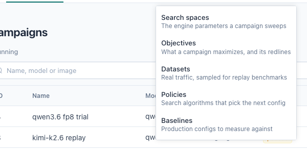

[User guide](README.md) › **First campaign**

# First campaign

From a fresh install to a tuned config: add the GPUs, define what to try, run
the campaign and read the result. The setup takes about fifteen minutes, plus
the time the runs take.

Terms in **bold** are defined in [Concepts](concepts.md).

> **Screenshots** on these pages come from a local kind setup with the mock
> engine on a simulated GPU cluster
> ([Local setup with kind](../install.md#local-setup-with-kind)), which can be
> used to follow along. Their numbers are not performance data.

## Prerequisites

- **LLM AutoTune and LLMBench installed** with `deploy/quickstart.sh`
  ([Installing](../install.md), step 1).
- **A GPU cluster prepared** with `deploy/gpu-cluster.sh`, which writes
  `llm-autotune-runs.kubeconfig` ([Installing](../install.md), step 2).
- **Model weights on the GPU nodes**, at the same path on each, such as
  `/data/models/Qwen3-8B`. Runs mount the weights from the node.
- **An engine image** the GPU nodes can pull, such as
  `lmsysorg/sglang:<version>` or `vllm/vllm-openai:<version>`.

## 1. Sign in

Open the address `deploy/quickstart.sh` printed (`http://localhost:8080` on a
local cluster) and sign in as `admin` with the printed password.
`deploy/quickstart.sh ui` prints both again.

The **Campaigns** page opens, empty. The top menu has three sections:

- **Campaigns**: every campaign, and a new one.
- **Runs**: every run of every campaign.
- **Resources**: GPU clusters and machines.
- **Library**: what a campaign is built from: Search spaces, Objectives,
  Datasets, Policies and Baselines.

The user menu (top right) has **Account** and **API keys**.

## 2. Add the GPU cluster

Open **Resources** and press **Add GPU cluster**. Upload
`llm-autotune-runs.kubeconfig` (**Upload file**, or paste it), name the
cluster, and press **Connect**.

The platform lists the cluster's GPU nodes and their GPUs. Keep **One pool per
GPU type** and **Lease them to the platform now** selected and press
**Register**.

Each GPU type becomes a leased **machine**: a pool of the nodes with that GPU.
Each run goes to whichever of them has room, and waits when none has.

> **Connect fails?** The error states whether the cluster's address did not
> resolve or did not respond from the platform's pods. Run `gpu-cluster.sh`
> again with `--api-server https://<address>:6443`
> ([Troubleshooting](troubleshooting.md#adding-a-gpu-cluster)).

The platform uses a machine only while it is leased; **End lease** returns it,
and the platform never stops workloads it did not start
([Machines and GPU clusters](machines.md)).

**Smoke test** checks that the platform can reach the machine and start pods
on it. Select **Probe pod** and press **Run again** to also schedule a small
pod on the node.

## 3. Create a search space

Open **Library ▸ Search spaces** and press **New search space**.

1. Enter a **Name** and select the **Engine** (`sglang` or `vllm`).
2. In **Add a parameter**, search for an engine setting and select it. The
   **?** next to each shows its description.
3. Choose a **Mode** for each parameter:
   - **Fixed**: one value for every candidate.
   - **Sweep**: values to try. Type a value and press Enter after each.
   - **Range** and **Tied**: see [Search spaces](search-spaces.md).

Start small. This space tries two tensor-parallel sizes against three memory
fractions, with the scheduling policy fixed:

The **Preview** shows the product: 2 × 3 = **6 candidates**, one run each.
Press **Save**.

> **On the mock engine,** `tp` and `mem_fraction_static` have no effect, so
> the ranking is noise except that `tp=2` uses two GPUs for the same
> throughput and scores half per GPU. To see the mock engine respond to a
> parameter, sweep `mock_token_ms: [2, 20]`.

## 4. Choose an objective

Open **Library ▸ Objectives**. The install provides six built-in
objectives. **Throughput per GPU** is the default: it ranks configs by output
tokens per minute divided by the GPUs they use.

For a latency limit, such as "first token within 2 seconds", use an objective
with a **redline**, or **Duplicate** one and edit it
([Objectives](objectives.md)).

## 5. Create the campaign

Open **Campaigns** and press **New campaign**. The wizard
has six steps; the **So far** panel on the right summarizes the campaign.
Click a step title to return to it.

**Model.** A campaign name, the engine **Container image**, and the **Model
path on the machine** (the weights folder on the GPU node, mounted at `/model`
in the container).

**Machines.** The machines that hold the model weights; leave empty to allow
any leased machine. **Parallel candidates** (on by default) lets several
candidates share a machine, each on its own GPUs.

**Search.** The **Search space** from step 3. **Strategy** selects how
candidates are chosen: **Grid (exhaustive)** tries every candidate in order,
suitable for a small space; a policy such as `random-search` chooses for
larger ones ([Search policies](policies.md)).

**Benchmark.** The **Workload** each candidate receives from LLMBench. A
**Synthetic sweep** sends random prompts of the given sizes at each
**Concurrency** level in turn; the line below it names the LLMBench benchmark
AutoTune creates. Then select the **Objective** from step 4.

> On a local kind setup, keep the workload small (128 input and 32 output
> tokens, concurrency `1, 4`, 5 requests per slot), since the benchmark client
> runs on the same machine. On real GPUs the defaults (2048 input, 512 output,
> concurrency up to 64) are a reasonable start.

**Schedule.** When the campaign may use the machines. The default is **Every
night**, 23:00 to 08:00. To run it only when started manually, select **No
window (start it by hand)**.

**Check.** Press **Run checks**. On a Kubernetes cluster, probe pods on each
machine pull the engine image and mount the model path, so a wrong image tag
or path is reported now. "Nothing is in the way" means the campaign is ready.
If a check fails, the step turns red and **Create campaign** asks for
confirmation.

Press **Create campaign**.

## 6. Start it

- **With a window:** the campaign is *scheduled* and starts when the window
  opens (immediately, if it is open). **Run now** starts it outside the window.
- **Without a window:** the campaign is a *draft*. Press **Start**.

While it runs, the **Runs** tab shows each run's stage (*launching*, *waiting
ready*, *health check*, *benching*) and the **Leaderboard** fills in as results
arrive. **Pause** lets current runs finish and starts nothing new; **Stop**
ends them immediately. See [Running a campaign](running-campaigns.md).

## 7. Read the result

When every candidate has been measured, the campaign is *done*. The
**Leaderboard** ranks the configs by the objective, best first:

- **Config** shows the values that differ between candidates.
- The score column is the objective's target metric, with its unit.
- **vs baseline** compares each config with production's, once a baseline is
  recorded ([Baselines](baselines.md)).
- **Redlines** shows whether the config **held** every limit or **crossed**
  one.

Click a row for the run's details: the score, the **Engine command** with a
copy button, the image and weights path, the full config, every metric
LLMBench reported, and the engine log. For a failed run, the error is shown
first.

The top row's engine command, image and weights are what to deploy
([Reading results](results.md#deploying-the-winner)). **Report** writes up the
campaign as Markdown:

## Next steps

- Record production's config on [Baselines](baselines.md), so results read as
  "+12% over production".
- Search a larger space with the `random-search` policy
  ([Search policies](policies.md)).
- Give a campaign a nightly window ([Running a campaign](running-campaigns.md)).
- [Troubleshooting](troubleshooting.md) lists common problems.

---

← [Concepts](concepts.md) · [User guide](README.md) · Next: [Machines and GPU clusters](machines.md) →
