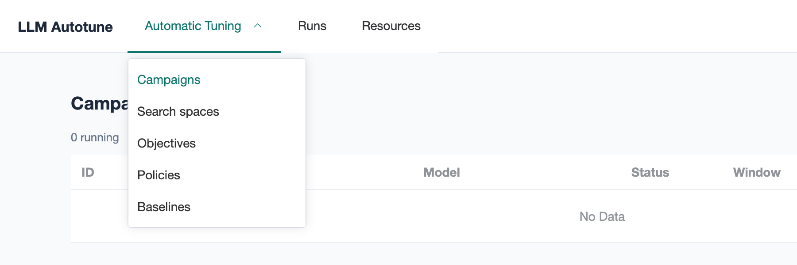
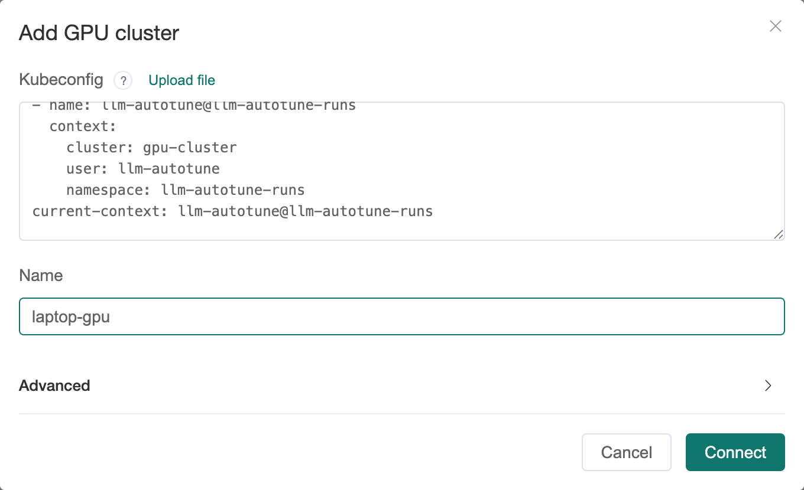
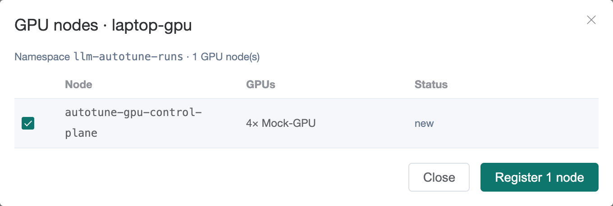
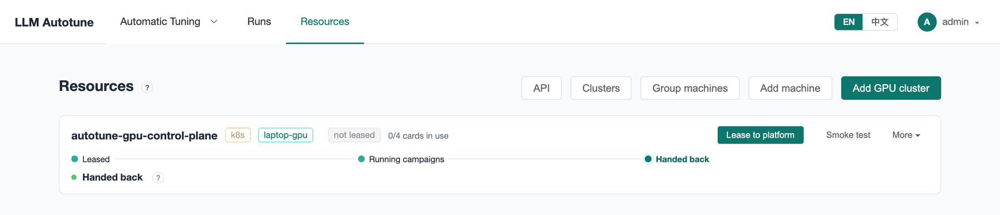
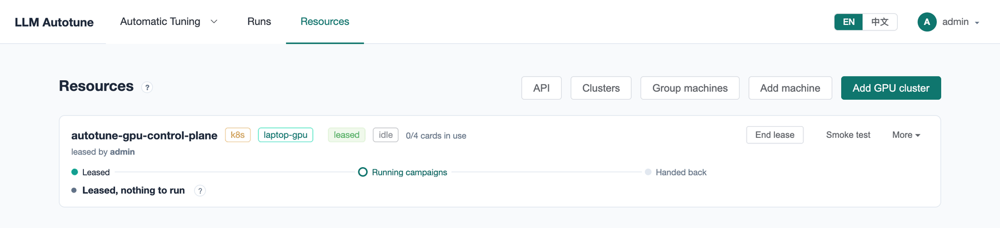
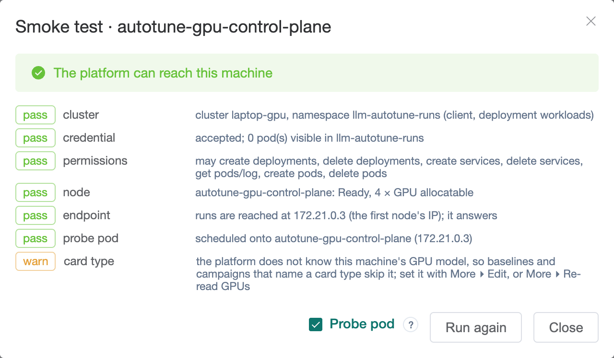
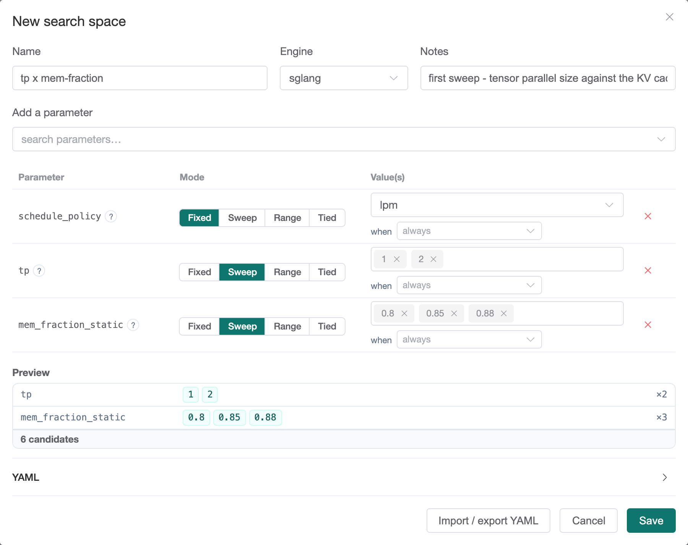
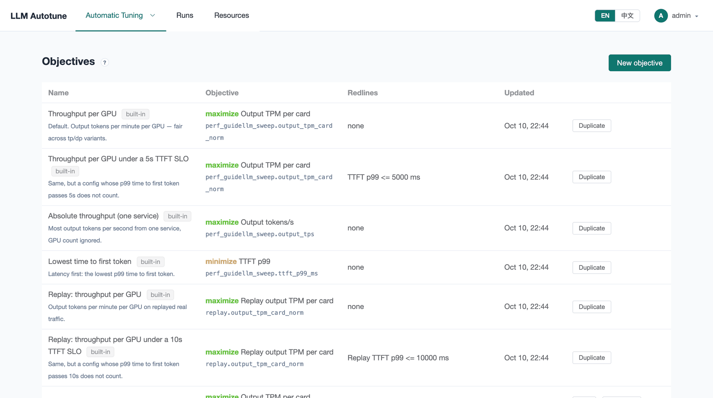

[User guide](README.md) › **Your first campaign**

# Your first campaign

This walks through everything from a fresh install to a tuned config: add the
GPUs, say what to try, run it, and read the result. It takes about fifteen
minutes of clicking, plus however long the runs take.

Words in **bold** that you have not seen before are explained in
[Concepts and words](concepts.md).

> **The screenshots** come from a laptop install, with the mock engine on a
> kind cluster that pretends to have GPUs
> ([Trying it all on a laptop](../install.md#trying-it-all-on-a-laptop)). You
> can follow along exactly that way. The numbers in them say nothing about
> real performance.

## Before you start

You need:

- **LLM AutoTune installed**, with LLMBench next to it. `deploy/quickstart.sh`
  does both ([Installing](../install.md), step 1).
- **A GPU cluster prepared** with `deploy/gpu-cluster.sh`, which writes the file
  `llm-autotune-runs.kubeconfig` ([Installing](../install.md), step 2).
- **The model weights on the GPU nodes**, at the same path on each, such as
  `/data/models/Qwen3-8B`. Runs mount the weights from the node.
- **An engine image** the GPU nodes can pull, such as
  `lmsysorg/sglang:<version>` or `vllm/vllm-openai:<version>`.

## 1. Sign in

Open the address `deploy/quickstart.sh` printed at the end
(`http://localhost:8080` on a cluster on your own machine). Sign in as
`admin` with the printed password. `deploy/quickstart.sh ui` prints both again.

You land on **Campaigns**, which is empty for now. The menu along the top has
three parts:

- **Automatic Tuning** opens the tuning pages: Campaigns, Search spaces,
  Objectives, Policies and Baselines.
- **Runs** lists every run of every campaign.
- **Resources** holds the GPUs: clusters and machines.

Your user menu (top right) has your **Account** and **API keys**.

## 2. Add the GPU cluster

Open **Resources** and press **Add GPU cluster**. Upload
`llm-autotune-runs.kubeconfig` (**Upload file**, or paste it), give the cluster
a name, and press **Connect**.

The platform reads the cluster's GPU nodes and lists them with their cards.
New nodes are ticked already. Press **Register**.

Each registered node becomes a **machine**: one place a run can land, pinned to
that node, with the card count the node reports.

> **Connect fails?** The message says whether the cluster's address did not
> resolve or did not answer from the platform's pods. Run `gpu-cluster.sh`
> again with `--api-server https://<address>:6443`
> ([troubleshooting](troubleshooting.md#adding-a-gpu-cluster-fails)).

## 3. Lease the machine

A machine starts *not leased*: the platform may not use it yet. Press
**Lease to platform**. The tag turns to *leased* and the track under the name
moves to its first step.

Leasing exists because these are often production GPUs lent for a while. The
platform only uses leased machines, and **End lease** gives one back; it never
stops anything it did not start. More in
[Machines and GPU clusters](machines.md).

Press **Smoke test** to check that the platform can reach the machine and start
pods on it. Tick **Probe pod** and **Run again** to also place a small pod on
the node.

## 4. Say what to try: a search space

Open **Automatic Tuning ▸ Search spaces** and press **New search space**.

1. Give it a **Name** and pick the **Engine** (`sglang` or `vllm`).
2. In **Add a parameter**, search for an engine setting and pick it. Each one
   has a **?** with what it does.
3. For each parameter choose a **Mode**:
   - **Fixed**: one value on every candidate.
   - **Sweep**: a list of values to try. Type a value and press Enter after each.
   - **Range** and **Tied** are explained in [Search spaces](search-spaces.md).

Start small. This one tries two tensor-parallel sizes against three memory
fractions, with the scheduling policy fixed:

The **Preview** multiplies it out: 2 × 3 = **6 candidates**, each one a run.
Press **Save**.

> **On the laptop** the mock engine ignores `tp` and `mem_fraction_static`, so
> the ranking is noise apart from one thing: `tp=2` takes two GPUs for the same
> speed, so it scores half per GPU. To see the mock respond to a setting, sweep
> its own knob, `mock_token_ms: [2, 20]`.

## 5. Say what "better" means: an objective

Open **Automatic Tuning ▸ Objectives**. The install comes with six built-in
objectives. **Throughput per GPU** is the default and a good first choice: it
ranks configs by output tokens per minute divided by the GPUs they use.

If you have a latency limit, such as "the first token within 2 seconds", use an
objective with a **redline**, or **Duplicate** one and change it
([Objectives](objectives.md)).

## 6. Create the campaign

Open **Automatic Tuning ▸ Campaigns** and press **New campaign**. The wizard has
six steps; the **So far** panel on the right sums up your answers as you go.
You can click any step to go back to it.

**Model.** A campaign name, the engine **Container image**, and the **Model
path on the machine**, the folder holding the weights on the GPU node. The
engine sees it as `/model` inside the container.

**Machines.** Pick the machines that hold the model's weights. Leave it empty
to allow any leased machine. **Parallel candidates** (on by default) lets
several candidates share one machine, each on its own GPUs.

**Search.** Pick the **Search space** from step 4. **Strategy** is how the
candidates are chosen: **Grid (exhaustive)** tries every one, in order, which
is right for a small space. A policy such as `random-search` picks for you on
larger ones ([Search policies](policies.md)).

**Benchmark.** The **Workload** is the load every candidate gets from LLMBench.
A **Synthetic sweep** sends random prompts of the sizes you set, at each
**Concurrency** level in turn. The line under it names the LLMBench benchmark
AutoTune will create for it. Then pick the **Objective** from step 5.

> On the laptop, keep the workload this small (128 input and 32 output tokens,
> concurrency `1, 4`, 5 requests per slot): the laptop runs the benchmark
> client too. On real GPUs the defaults (2048 in, 512 out, concurrency up to
> 64) are a sensible start.

**Schedule.** When the campaign may use the machines. The default is
**Every night**, from 23:00 to 08:00. To run it only when you press **Start**,
choose **No window (start it by hand)**.

**Check.** Press **Run checks**. On a Kubernetes cluster a probe pod on each
machine pulls the engine image and mounts the model path, so a wrong image tag
or path shows up now, not at the first run. "Nothing is in the way" means
you're ready. If the checks find a problem, the step turns red, and **Create
campaign** asks before creating the campaign anyway.

Press **Create campaign**.

## 7. Start it

What happens next depends on the schedule:

- **With a window:** the campaign is *scheduled* and starts by itself when the
  window opens (or straight away, if it is open now). **Run now** starts it at
  once anyway.
- **Without a window:** the campaign is a *draft*. Press **Start**.

While it runs, the **Runs** tab shows each run going through its stages
(*launching*, *waiting ready*, *health check*, *benching*) and the
**Leaderboard** fills in as results arrive. **Pause** lets the current runs
finish and starts nothing new; **Stop** ends them at once. More in
[Running a campaign](running-campaigns.md).

## 8. Read the result

When every candidate has been measured the campaign is *done*. The
**Leaderboard** ranks the configs by the objective, best first, with a bar for
each:

- **Config** shows the values that differ between candidates.
- The score column is the objective's target metric, with its unit.
- **vs baseline** compares each config with production's, once you have
  recorded one on [Baselines](baselines.md).
- **Redlines** says whether the config **held** every limit or **crossed** one.

Click a row on the **Runs** tab for everything about one run: the score, the
full config, the exact **Launch command** (folded; click to open it), every
metric LLMBench reported, and the engine's log. For a failed run, what went
wrong comes first.

**Report** writes the whole campaign up as Markdown, ready to paste into a
ticket or chat.

The winner's run page has its launch command and image: apply those to your
serving deployment ([Reading results](results.md#taking-the-winner-to-production)).

## Where to go next

- Record what production runs today on [Baselines](baselines.md), so results
  read as "+12% over production".
- Try a bigger space with the `random-search` policy
  ([Search policies](policies.md)).
- Let it work at night: give a campaign a window and leave it
  ([Running a campaign](running-campaigns.md)).
- If anything misbehaved: [Troubleshooting](troubleshooting.md).

---

← [Concepts and words](concepts.md) · [User guide](README.md) · Next: [Machines and GPU clusters](machines.md) →
