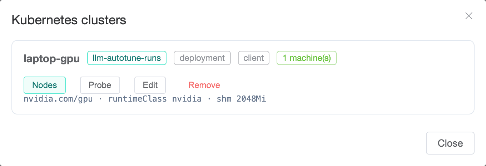

[User guide](README.md) › **Machines and GPU clusters**

# Machines and GPU clusters

The **Resources** page manages where runs happen. A **machine** is one place a
run can land:

- **A GPU node of a Kubernetes cluster.** Add the cluster once; each GPU node
  you register becomes a machine. This is the usual setup.
- **A bare-metal machine reached over ssh.** The platform connects and starts
  the engine with `docker run`.

The platform uses a machine only while it is **leased**.

## Adding a GPU cluster

*Admins only;* other users do not see **Add GPU cluster**. First run
`deploy/gpu-cluster.sh --context <gpu-cluster>` with the cluster's admin
kubeconfig ([Installing, step 2](../install.md#2-prepare-a-gpu-cluster)). It
creates a namespace for runs (`llm-autotune-runs`) and a ServiceAccount that
can manage only the platform's own workloads there and read nodes, and writes
`llm-autotune-runs.kubeconfig` holding only that account's token.

Press **Add GPU cluster**, upload the file, name the cluster and press
**Connect**.

The kubeconfig is stored encrypted and never shown again. **Advanced** holds
settings most clusters do not need:

| setting | when to change it |
|---|---|
| **Namespace** | The namespace runs go into. Read from the kubeconfig. |
| **Workload kind** | `deployment` (default) creates each run as a Deployment; `custom` hands runs to the optional TuningRun operator ([operator/INSTALL.md](../../operator/INSTALL.md)). |
| **RuntimeClass** | The runtime class engine pods request, `nvidia` by default. |
| **GPU resource** | The resource name GPUs are requested by, `nvidia.com/gpu` by default. |
| **Extra tolerations** | For GPU nodes with taints other than the standard GPU taint, which is tolerated automatically. Comma-separated `key[=value][:effect]`. |
| **Image pull secrets** | For engine images in a registry that requires credentials: names of secrets in the runs' namespace. |

After **Connect**, the platform lists the cluster's GPU nodes and their GPUs.
Select the nodes to use (new nodes are selected by default) and press
**Register**. With **Lease them to the platform now** selected (the default),
the new machines are leased immediately.

### The Clusters dialog

**Clusters** lists the added clusters.

- **Nodes** registers nodes added to the cluster since, and lists registered
  machines whose node no longer exists.
- **Probe** checks that the credential still works and refreshes the cluster's
  details.
- **Edit** changes its settings, including some available only here:
  - **Endpoint host**, the address runs are reached on (by default the node's
    own address);
  - the size of `/dev/shm` in engine pods;
  - a **Default node selector**;
  - CPU and memory requests and limits for engine pods.

  Leave **Kubeconfig** empty to keep the stored one, or paste a new one to
  replace it.
- **Remove** deletes the cluster and its stored kubeconfig from the platform.
  Its machines must be removed (or moved to another cluster) first. Nothing on
  the cluster changes; `deploy/gpu-cluster.sh remove` revokes the account
  there.

## The machine card

- **Name.** For a cluster node, the node's name.
- **Tags:** `k8s` and the cluster name for a cluster node, and the lease
  state: *not leased*, *leased*, *running* (runs in progress) or *handing
  back*. While leased, also the readiness reported to the lease API: *idle*,
  *busy* or *returnable*.
- **Cards in use**, out of the machine's total, and the GPU type when known.

The track below shows the lease stage: **Leased**, **Running campaigns**,
**Handed back**. The sentence under it describes the current state; its **?**
explains what ending the lease would do. Campaigns using the machine are
linked below.

## Leases

**Lease to platform** lets campaigns use the machine. Runs start on it only
while it is leased, and only inside a campaign's window.

To end the lease:

- **End lease:** runs in progress finish and nothing new starts (the machine
  shows *handing back*), then the machine is released. The dialog shows the
  expected wait.
- **More ▸ End lease now (stops runs):** stops the platform's runs on the
  machine immediately; their measurements are lost.

In both cases only the platform's own runs stop; nothing else on the machine
is touched.

Another system, such as a scheduler that leases idle GPUs at night, can lease
machines through the [machine lease API](../api/machine-lease.md). **API** on
this page opens the API reference.

## Smoke test

**Smoke test** checks that the platform can reach the machine and has the
permissions a run needs. On a cluster node it checks the credential, the
permissions, that the node is ready with free GPUs, and that runs on it are
reachable. Select **Probe pod** and press **Run again** to also schedule a
small pod on the node, requesting no GPUs.

A *warn* line does not block runs. A *fail* line names what to fix.

## More ▸

- **Edit** changes the machine's name, GPU count, GPU type and notes.
- **Remove** deletes it from the platform; its finished runs are kept. On a
  cluster, **Clusters ▸ Nodes** can register the node again.
- **Re-read GPUs** reads the GPU count and type from the machine again.

Set the **GPU type** (such as `H100`) when the platform cannot detect it.
Results are compared with a baseline only on the same GPU type.

A machine cannot be edited or removed while an unfinished campaign uses it.
Close those campaigns first: **⋯ ▸ Mark as done** on a stopped campaign, or
**⋯ ▸ Delete** on one that never ran.

## Bare-metal machines over ssh

The worker connects over ssh and runs the engine with `docker run`.

1. Give the worker an ssh key at install time (`worker.ssh` in the values; see
   [After installing](../after-installing.md#bare-metal-machines-over-ssh)).
2. Add the key's public half to the ssh user's `~/.ssh/authorized_keys` on the
   machine. The machine needs Docker and the NVIDIA container toolkit.
3. Press **Add machine**, keep **Driver** at *SSH + Docker*, and enter a
   **Name** and the **Host** address. The GPU count and type are read over ssh
   when you save; if the machine cannot be read, the save is refused and
   **Advanced** opens so you can enter the GPU count. **Advanced** also has the
   ssh user and port, and notes.
4. **Smoke test** the machine, then **Lease to platform**.

**Add machine** with the *Kubernetes* driver is for a special case: a slice of
an added cluster, limited by a **Node selector** (`label=value`), for example
for a model whose weights are only on some nodes. **Add GPU cluster** already
registers each GPU node, so this is rarely needed.

## Node groups (multi-node)

A model too large for one node can be served across several. **Group
machines** joins leased machines into a named group; the first one selected is
the master. Members must share a driver, a GPU type and a GPU count.

A group is not a reservation: each member remains an ordinary machine other
campaigns can use, and is occupied only while a multi-node run is deployed on
it. **Preflight** on a group checks that every member is ready and can reach
the master. A campaign selects the group on its **Machines** step (sglang
only). Most setups do not need one.

---

← [First campaign](first-campaign.md) · [User guide](README.md) · Next: [Search spaces](search-spaces.md) →
