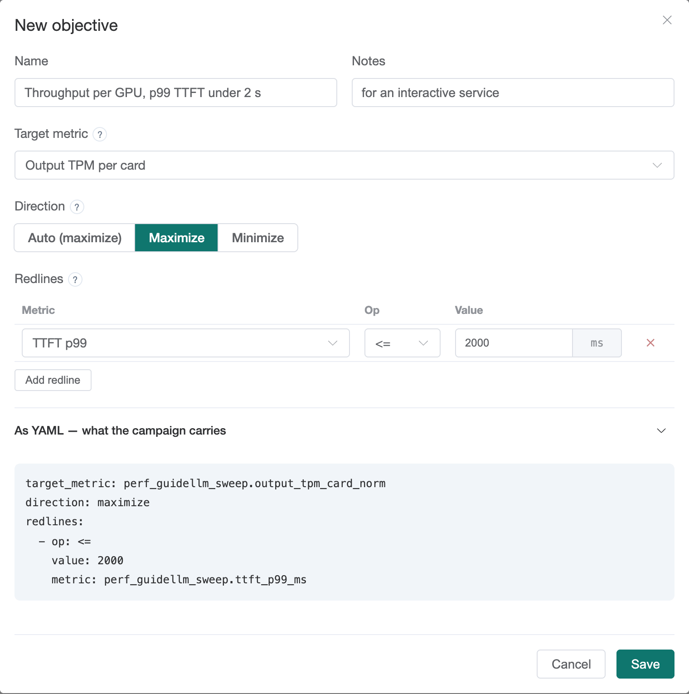

[User guide](README.md) › **Objectives**

# Objectives

An **objective** says what "better" means for a campaign:

- a **target metric**, the one number candidates are ranked by;
- a **direction**: maximize it (throughput) or minimize it (latency);
- **redlines**, limits a config must stay within to rank at all.

Objectives are under **Automatic Tuning ▸ Objectives**. A campaign copies its
objective when it is created, so editing an objective later does not re-rank
existing campaigns.

## The built-in objectives

The install provides six. They cannot be edited; **Duplicate** makes an
editable copy.

| objective | ranks by | use it when |
|---|---|---|
| **Throughput per GPU** (the default) | output tokens per minute, per GPU | you want the most work out of each card |
| **Throughput per GPU under a 5s TTFT SLO** | the same, with p99 time to first token ≤ 5 s | you also promise users a first token within 5 s |
| **Absolute throughput (one service)** | output tokens per second of one service | the GPU count is fixed and you size one deployment |
| **Lowest time to first token** | p99 time to first token, lowest first | latency matters more than throughput |
| **Replay: throughput per GPU** | output tokens per minute per GPU, on replayed traffic | the campaign's workload is a replay |
| **Replay: … under a 10s TTFT SLO** | the same, with replayed p99 TTFT ≤ 10 s | a replay, with a latency promise |

**Why per GPU?** A config that uses more GPUs is almost always faster in
total, so ranking by total throughput favors the widest configs. Dividing by
the GPUs used measures the throughput each GPU delivers, so `tp=1` and `tp=2`
compare fairly.

## Creating an objective

Press **New objective**, or **Duplicate** a similar one.

- **Target metric.** Pick from the list, grouped by the benchmark that
  reports it: *Synthetic sweep*, *Production replay* and *Whole submission*.
  The **?** explains the chosen metric and its unit.
- **Direction.** **Auto** follows the metric: latency metrics are minimized,
  throughput metrics maximized. Set it yourself only to override that.
- **Redlines.** A new objective has none. **Add redline** suggests p99 time to
  first token from the same benchmark as the target metric; change the metric
  if needed, select an operator (`<=`, `<`, `>=`, `>`, `==`, `!=`) and enter
  the limit. The unit is shown next to it: milliseconds for latencies, tokens
  per second or minute for throughput, a fraction from 0 to 1 for rates.
  "TTFT p99 `<=` 2000 ms" means the first token arrives within 2 seconds for
  99% of requests.
- **As YAML** shows exactly what a campaign will store.

A config that crosses a redline is rejected regardless of its score. A metric
the benchmark did not report counts as crossed, so a redline on a replay
metric rejects every config in a campaign whose workload is a synthetic
sweep.

## Common metrics

Metric names are `<benchmark module>.<metric>`. The synthetic sweep's module
is `perf_guidellm_sweep`, a replay's is `replay`.

| metric | label | meaning |
|---|---|---|
| `perf_guidellm_sweep.output_tpm_card_norm` | Output TPM per card | output tokens per minute, per GPU. The default. |
| `perf_guidellm_sweep.total_tpm_card_norm` | Total TPM per card | input + output tokens per minute, per GPU, when prompts are a real part of the cost |
| `perf_guidellm_sweep.output_tps` | Output tokens/s | total output speed of one service |
| `perf_guidellm_sweep.request_output_tps` | Single-stream output tokens/s | how fast one request's answer streams under load. Good as a floor (`>=`). |
| `perf_guidellm_sweep.ttft_p99_ms` | TTFT p99 | time to first token, worst 1%. The usual latency redline. |
| `perf_guidellm_sweep.itl_p99_ms` | Inter-token latency p99 | the longest pauses between streamed tokens |
| `functional_acceptance.pass_rate` | Functional pass rate | share of correctness checks passed, when the benchmark includes them. A redline, such as `>= 0.95`. |
| `replay.score_card_norm` | Replay value per card | LLMBench's value-weighted replay score, per GPU |
| `replay.ttft_p99_ms` | Replay TTFT p99 | time to first token on real prompts |

## Metrics available to a campaign

The workload determines the metrics: a synthetic sweep reports
`perf_guidellm_sweep.*`, a replay `replay.*`. The **Benchmark** step of New
campaign lists only objectives whose target metric the chosen workload
reports.

---

← [Search spaces](search-spaces.md) · [User guide](README.md) · Next: [Datasets](datasets.md) →
