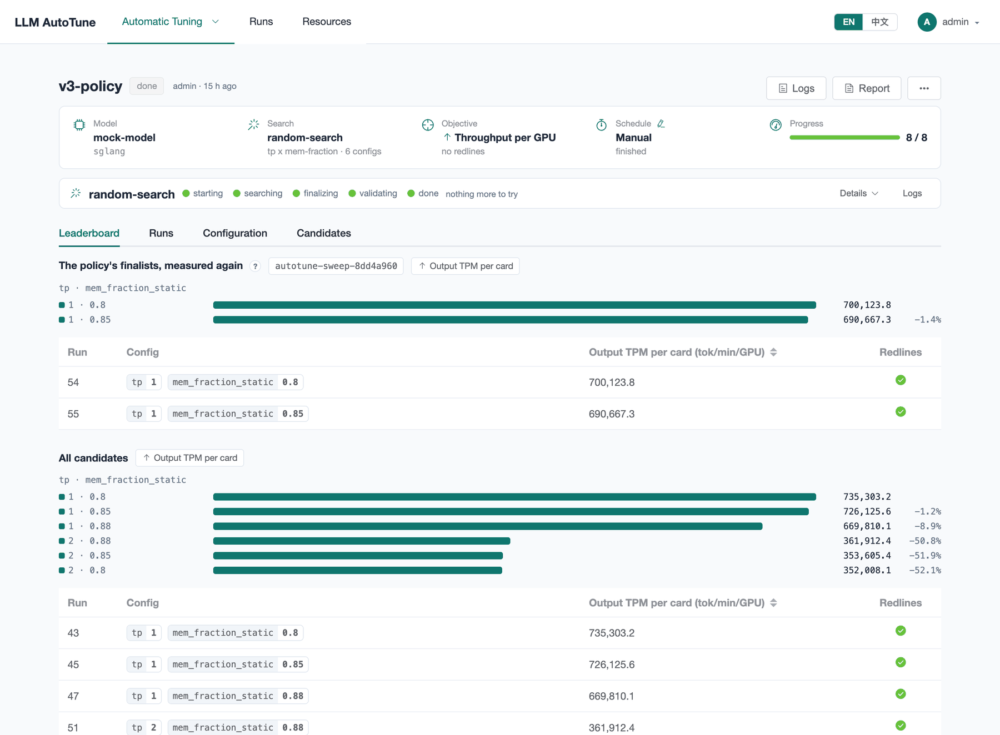

[User guide](README.md) › **Search policies**

# Search policies

A campaign chooses which candidates to try, and in what order, in one of two
ways:

- **Grid (exhaustive).** No policy: the campaign tries every candidate in the
  search space, in order. Simple, repeatable and complete; suitable for small
  spaces of a few dozen candidates. If the window closes first, the next
  window continues where it stopped.
- **A policy.** A search algorithm packaged as a container. It uses the
  results so far to choose what to try next, so it can explore a large space
  without trying every candidate.

In both cases the platform starts every engine, benchmarks it the same way and
determines the winner. A policy only chooses configs; it never grades its own
results.

## The Policies page

**Automatic Tuning ▸ Policies** lists the registered policies, the image each
one runs, and how many campaigns use it.

The install registers **random-search** from its published image on ghcr.io.
It samples untried candidates at random, up to 60 trials. It is the reference
any better search should beat, and the template for writing a policy.

## How a policy campaign runs

Select the policy on a campaign's **Search** step, under **Strategy**. The
step then asks for **Finalists**: how many of its best configs the policy
returns at the end (2 by default).

When the campaign starts, the platform runs the policy as a pod on the GPU
cluster, alongside the runs. The campaign page shows its progress as a
**session**:

1. **starting**: the policy pod is being scheduled and pulled.
2. **searching**: the policy requests configs one after another; the platform
   launches and measures each one and returns the result. Each config tried
   is a **trial**.
3. **finalizing**: near the end of the window, or when the policy has nothing
   left to try, it names its finalists.
4. **validating**: the platform launches the finalists and measures them
   again itself, on the campaign's own benchmark (or on its second benchmark,
   if the campaign has a [verify stage](campaigns.md#4-benchmark)). That
   measurement decides the winner.
5. **done**.

On the **Leaderboard**, the top board is **The policy's finalists, measured
again**: the measurement that decides. **All candidates** below it lists every
config the policy tried.

The time validation needs is reserved from the search, based on how long the
campaign's runs take.

The strip's **Logs** shows the policy container's log, and **Abort** ends the
session. A warning line under it shows what a stalled policy is waiting for,
such as free GPUs. The policies built on the SDK log each step (the plan,
every launch and its result, the platform's commands), and the campaign's
**Activity** log has the platform's side of it.

## Registering a policy

Press **Register policy** and enter a **Name** and an **Image**. Use a fixed
version tag, not `latest`, so a campaign can be repeated with the same search.

Under **Advanced**:

| setting | what it does |
|---|---|
| **Version**, **Source repository** | shown on the list, for reference |
| **Mount the model weights** | gives the policy container the model folder. Leave off for a policy that only asks the platform to start engines; on Kubernetes the mount pins it to a node that has the weights. |
| **Give the container the GPUs** | for a policy that starts engines inside its own container instead of asking the platform |
| **Ports it may use** | how many ports the policy may use |
| **Environment (YAML)** | environment variables for the container, for a policy with options |

A policy's pod runs on the GPU cluster, so the GPU nodes must be able to pull
its image. If they cannot reach ghcr.io, mirror the image to a reachable
registry and update the **Image** here, or build it from source with
`deploy/quickstart.sh policy`
([After installing](../after-installing.md#search-policies)).

A policy used by a campaign can be edited but not removed.

## Writing a policy

A policy is any container that implements a small HTTP API. The quickest
start is to copy `random-search` and replace its strategy, a class with five
methods:

- **The policies repository:**
  [llm-autotune-policies](https://github.com/modelsphere/llm-autotune-policies),
  with the SDK, `random-search` and a fault-injection policy (`chaos`).
- **The API in short:** [Policy API](../api/policy-api.md).
- **The full contract:** [Policy contract](../api/policy-contract.md).
- **Building and registering it** with one command:
  [After installing](../after-installing.md#search-policies).

---

← [Datasets](datasets.md) · [User guide](README.md) · Next: [Creating a campaign](campaigns.md) →
