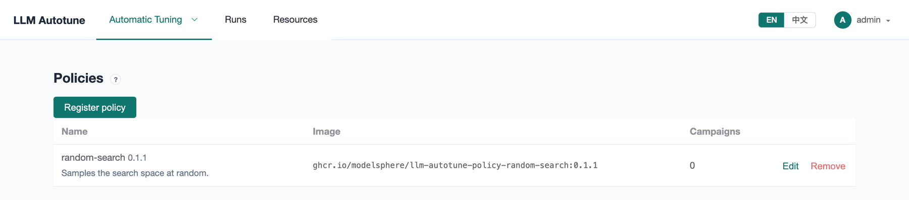
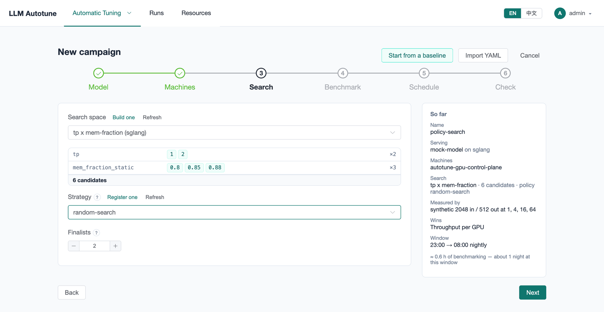
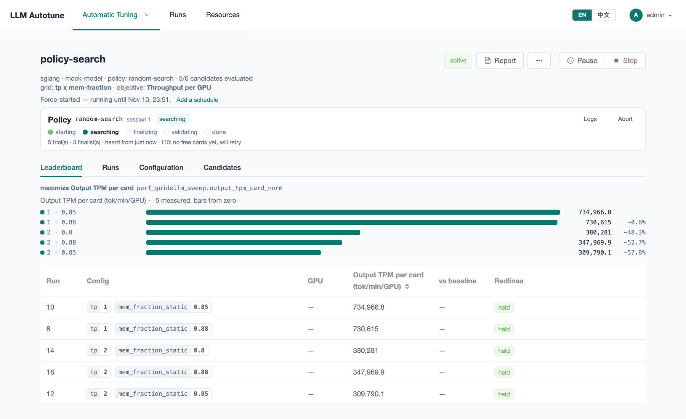
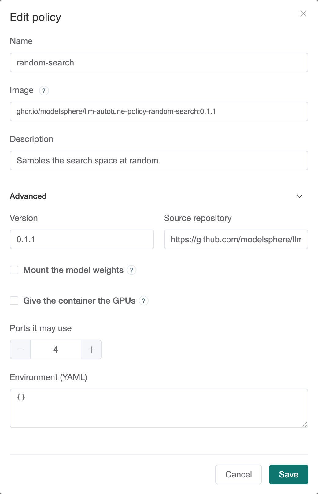

[User guide](README.md) › **Search policies**

# Search policies

A campaign has to decide which candidates to try, and in what order. There are
two ways:

- **Grid (exhaustive).** No policy: the campaign tries every candidate in the
  search space, in order. Simple, repeatable and complete. It is the right
  choice while the space is small, a few dozen candidates at most. If the window
  closes first, the next window carries on where it stopped.
- **A policy.** A search algorithm packaged as a container. It looks at the
  results so far and picks what to try next, so it can cover a large space
  without trying all of it.

Either way, the platform starts every engine, benchmarks it the same way and
decides the winner itself. A policy only chooses; it never grades its own
results.

## The Policies page

**Automatic Tuning ▸ Policies** lists the registered policies, the image each
one runs, and how many campaigns use it.

The install registers **random-search** from its published image on ghcr.io.
It samples untried candidates at random, up to 60 trials. It is
the baseline any smarter search should beat, and the template for writing your
own.

## How a policy campaign runs

Pick the policy on a campaign's **Search** step, under **Strategy**. The step
then asks for **Finalists**: how many of its best configs the policy hands
back at the end (2 by default).

When the campaign starts, the platform runs the policy as a pod on the GPU
cluster, next to the runs. The campaign page shows its progress as a
**session**:

1. **starting**: the policy pod is being scheduled and pulled.
2. **searching**: the policy asks for configs one after another; the platform
   launches and measures each and reports back.
3. **finalizing**: near the end of the window, or when the policy has nothing
   left to try, it names its finalists.
4. **validating**: the platform measures the finalists again itself. That
   measurement decides the winner.
5. **done**.

The time validation needs is held back from the search, based on how long this
campaign's runs actually take.

The panel's **Logs** shows the policy's own log, and **Abort** ends the
session. **Waiting on:** says what a stuck policy is waiting for, such as free
GPUs.

## Registering a policy

Press **Register policy**: a **Name** and an **Image**. Use a fixed version tag,
not `latest`, so the campaign can be re-run with the same search.

Under **Advanced**:

| setting | what it does |
|---|---|
| **Version**, **Source repository** | shown on the list, for reference |
| **Mount the model weights** | gives the policy container the model folder. Off for a policy that only asks the platform to start engines; on Kubernetes the mount would tie it to a node that has the weights. |
| **Give the container the GPUs** | for a policy that starts engines inside its own container instead of asking the platform |
| **Ports it may use** | how many ports the policy may use |
| **Environment (YAML)** | environment variables for the container, for a policy with options |

A policy's pod runs on the GPU cluster, so the GPU nodes must be able to pull
its image. If they can't reach ghcr.io, copy the image into a registry they
can reach and change the **Image** here, or build it from source with
`deploy/quickstart.sh policy`
([After installing](../after-installing.md#search-policies)).

A policy used by a campaign can be edited but not removed.

## Writing your own

A policy is any container that speaks a small HTTP API with the platform. The
quickest start is to copy `random-search` and replace its strategy, a class
with five methods:

- **The policies repository:**
  [llm-autotune-policies](https://github.com/modelsphere/llm-autotune-policies),
  with the SDK, `random-search` and a fault-injection policy (`chaos`).
- **The API in short:** [Policy API](../api/policy-api.md).
- **The full contract:** [Policy contract](../api/policy-contract.md).
- **Building and registering it** with one command:
  [After installing](../after-installing.md#search-policies).

---

← [Objectives](objectives.md) · [User guide](README.md) · Next: [Creating a campaign](campaigns.md) →
