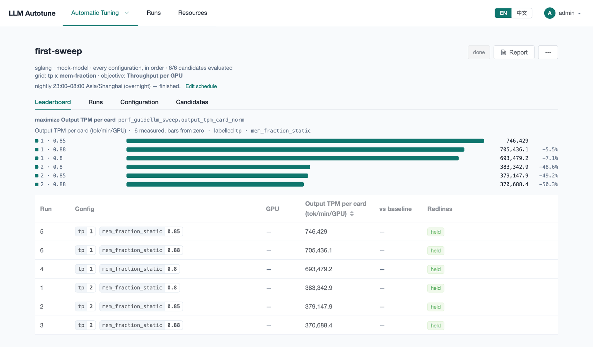
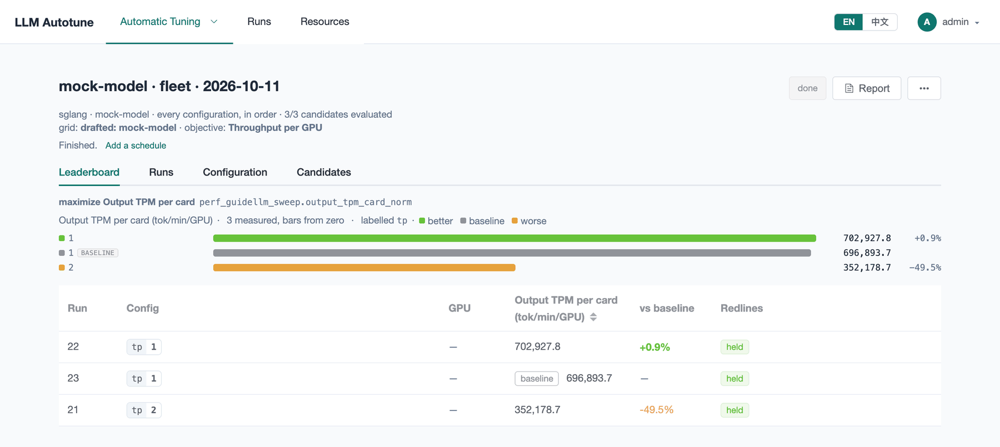
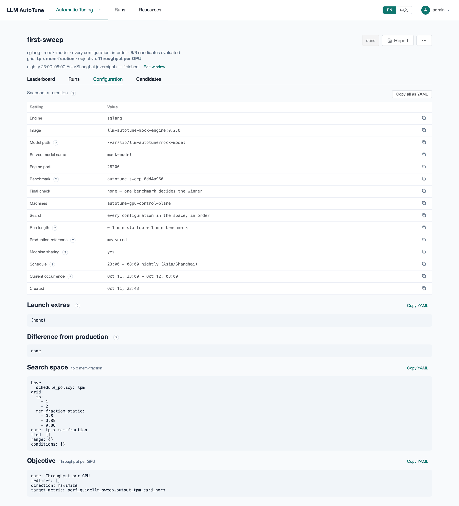
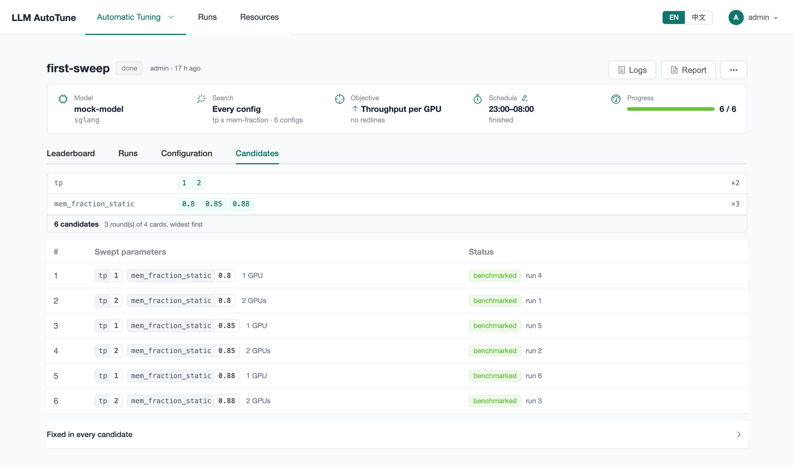
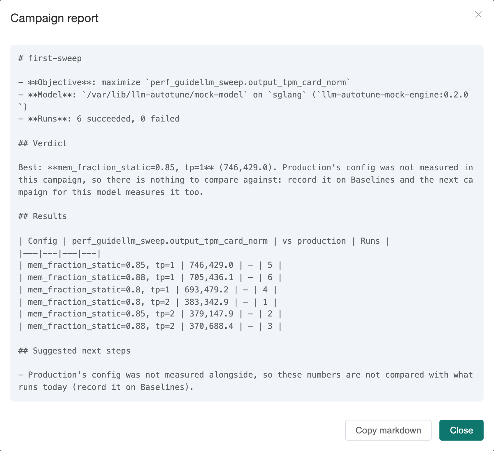

[User guide](README.md) › **Reading results**

# Reading results

A campaign's page has four tabs: **Leaderboard**, **Runs**, **Configuration**
and **Candidates**. **Report** above them produces a Markdown summary.

## Leaderboard

The line at the top restates the objective: the direction, the target metric's
label and its full name, and the redlines, if any.

The bars show every measured config, best first, labeled with the values of
the swept parameters in order (`1 · 0.85` is `tp=1`, `mem_fraction_static=0.85`).
The percentages on the right compare each config with the baseline, or with
the best config when there is no baseline.

The table has one row per measured config; click a row to open the run that
produced its score:

| column | means |
|---|---|
| **Run** | the run that produced the score; its details are on the **Runs** tab |
| **Config** | the values that vary between candidates. The fixed ones are on the **Candidates** tab. |
| **GPU** | the card type it ran on, when known. Yellow when it differs from the baseline's card, which makes the comparison unfair. |
| score | the target metric, with its unit, such as *Output TPM per card (tok/min/GPU)* |
| **vs baseline** | how it compares with production's config measured in the same campaign, such as `+12.0%`. Empty when there is no baseline ([Baselines](baselines.md)). |
| **Redlines** | **held** if the config kept within every redline; **crossed** with which one if not. A crossed config never wins. |

A row tagged **baseline** is production's config, measured the same way in
the same campaign. With a baseline, the bars are green (better than the
baseline), grey (the baseline) or orange (worse):

Here `tp=1` matches production's config apart from a flag the mock engine
ignores, so its +0.9% is measurement noise; `tp=2` halves the throughput per
GPU.

### Two boards

Some campaigns show two boards; the top one decides:

- **The policy's finalists, measured again**, in a policy campaign: the configs
  the policy named as its best, launched and measured by the platform itself
  on the campaign's benchmark. **All candidates** below is every config the
  policy tried.
- **Verified on real traffic**, in a campaign with a
  [verify stage](campaigns.md#4-benchmark): the best few configs measured
  again with the second workload. **All candidates** below is the first,
  quicker measurement of every config. Their numbers come from different
  benchmarks, so they are never mixed in one table. A replay row tagged
  **other dataset** was measured on a different sample of the dataset and does
  not compare with the rest.

## Runs

The **Runs** tab lists every run: its status, the failure kind if it failed,
the machine's GPUs it held (`#0 #1`), its endpoint, when it started and how
long it took. In a policy campaign, each trial is one row (**Role** *trial*)
with its benchmark run nested under it, and *finalist* rows are the platform's
final measurements. Click a row for the details:

- **Error** (failed runs, shown first): what went wrong, and the failure kind.
- **Verdict:** the benchmark that measured it, the ranking metric, its score,
  and whether it held the redlines.
- **What the objective looked at:** the target metric and every redline
  metric.
- **Engine command:** the engine's command line for this config, with a
  **Copy** button, followed by the image and weights path.
- **Config:** the full set of engine settings, including fixed ones.
- **Launch command, as applied** (collapsed): exactly what was started. On
  Kubernetes, the applied manifest; over ssh, the `docker run` line.
- **Results:** everything LLMBench reported, under **Metrics**.
- **Captured log:** the engine's output, live while the run is active and its
  end after it finishes. **Download** saves it.

[Runs and failures](runs.md) explains the statuses and failure kinds.

## Configuration

**Configuration** shows the campaign as created: every setting, the launch
extras, the search space and the objective, each with a copy button. Later
edits to the original search space or objective do not change it.

**Difference from production** lists flags that production's recorded
baseline sets and this campaign does not. The results do not account for
these differences.

## Candidates

**Candidates** lists every config in the search space and its outcome:

| status | means |
|---|---|
| **queued** | waiting for a machine |
| a run state, such as **benching** | being measured now |
| **benchmarked** | measured; its score is on the leaderboard |
| **failed** | every attempt failed; the reason is next to it |
| **stopped** | its run was stopped |
| **rejected** | the static check refused it before launch (for example, more GPUs than any machine has) |

The map at the top shows the space and how its candidates fit on the machines
("3 rounds of 4 cards, widest first"). Click a row to open its run. **Fixed in
every candidate** lists the settings that never change.

## The report

**Report** summarizes the campaign as Markdown: the objective and model, a
verdict, results against production, configs that crossed a redline,
failures, and suggested next steps. **Copy markdown** copies it to the
clipboard.

The report does not claim a win the data does not support. A lead smaller
than the measurement noise is reported as *no meaningful difference*; when
repeated measurements of the same config disagree by more than the lead, the
result is *unstable*. When production's config was not measured (no
[baseline](baselines.md) for the model), the report says so.

## Comparing campaigns

Two results are comparable only when measured the same way:

- **the same benchmark**: the same workload always maps to the same LLMBench
  benchmark, named on the **Benchmark** step and in each run's details;
- **the same card type**;
- for a replay, **the same dataset sample**.

Results from different workloads are different measurements, even when the
metric has the same name.

## Deploying the winner

Click the top row of the leaderboard. The run details show:

- the **Engine command**, with a **Copy** button: the engine's command line
  for the winning config, as it runs inside the image with the weights at
  `/model`;
- the **Image** and **Weights** path;
- the engine version and image digest, in the results.

Apply these to the serving deployment, by hand or from a pipeline. Then update
the baseline on [Baselines](baselines.md), so the next campaign measures
against the new production config.

### Publishing it to the model catalog

**⋯ ▸ Export to model catalog** turns measured runs into an entry for
[model-catalog](https://github.com/modelsphere/model-catalog): a
`catalog.swiss/v1` version file with one variant per run, and a
`metadata.yaml` for a model the catalog doesn't have yet.

- **Runs:** every run on the leaderboard is listed. The baseline and the
  winner are ticked to start, as roles *baseline* and *optimized*; the
  optimized variant's description states how much it gained.
- **Entry:** the name, version and metadata are drafted from the model and
  can be edited. The weights are named by `source.hf`, never by a path on
  your machines.
- **Advanced:** variant ids, the default variant, env and host-path volumes,
  the startup budget, `gpuProduct` node labels, extending an already
  published version, and a saved report to ship next to the entry.

The files are checked against the catalog's schema as you go. Nothing is
pushed: download them, put them under `models/<name>/` in model-catalog, and
open a pull request. The provenance lines (which campaign and run measured
each variant) are for the pull request description.

---

← [Running a campaign](running-campaigns.md) · [User guide](README.md) · Next: [Baselines](baselines.md) →
