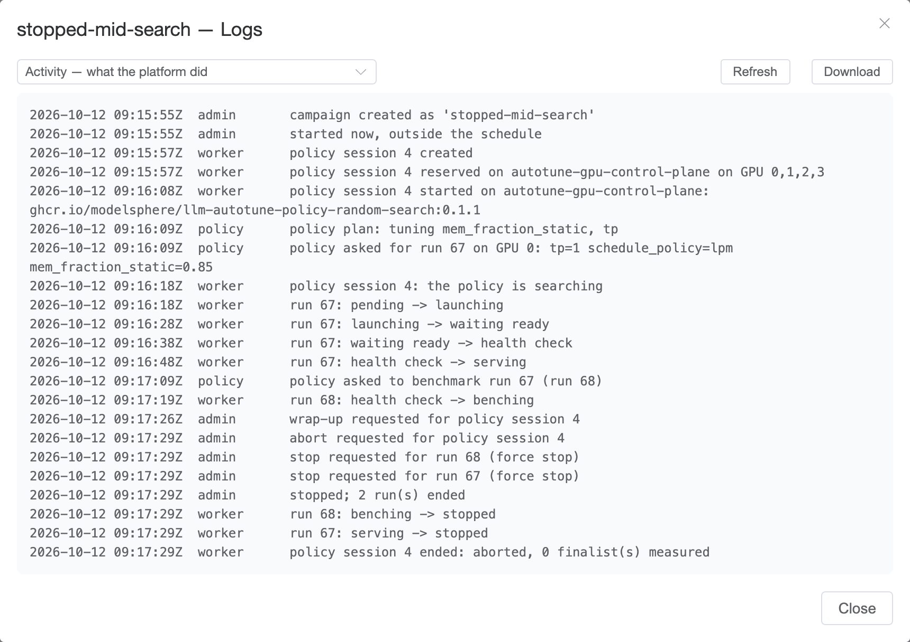

[User guide](README.md) › **Running a campaign**

# Running a campaign

Each campaign has a page, opened from **Campaigns**. This
page covers starting, pausing and stopping a campaign, its schedule, and what
the page shows while it runs. Results are covered in
[Reading results](results.md).

The **Campaigns** list filters by status, owner, model and engine, and
searches names, models and images. The filters are kept in the page's
address, so a filtered list can be shared as a link.

## The campaign page

- **Heading:** the name, the status, the owner and when it was created;
  **Logs**, **Report**, **⋯** (Copy to a new campaign, Export YAML, and Mark
  as done or Delete when available) and the run controls.
- **Summary:** one tile each for the **Model** (and engine), the **Search**
  (the policy, or every config; the search space and its size), the
  **Objective** (an arrow for higher or lower is better; the redlines), the
  **Schedule** (the window and what happens next), the **Progress** (configs
  measured, and how many are running or failed) and, for a replay benchmark,
  the **Replay sample**. Hover a tile for its details. The pencil next to
  **Schedule** edits the window.
- **The policy strip** appears for a policy campaign
  ([below](#a-policy-campaign)).
- **The tabs**: Leaderboard, Runs, Configuration and Candidates
  ([Reading results](results.md)).

## Statuses

| status | means |
|---|---|
| **draft** | Created, never started, and no window. Press **Start**. |
| **scheduled** | Waiting for its window; it starts by itself when the window opens. |
| **active** | Running: using machine time inside its window, or since you started it. |
| **paused** | Held by a person. The schedule does not restart it. |
| **done** | Every candidate measured, the schedule has no windows left, or marked done by hand. |

*Scheduled* and *paused* both mean "not running now": a scheduled campaign
waits for its window, a paused one for a person. A paused campaign does not
restart when its window opens.

## The run controls

The buttons on the right change with the status:

| status | buttons |
|---|---|
| draft | **Start** |
| scheduled | **Run now**, **Pause** |
| active | **Pause**, **Stop** |
| paused, with a window | **Run now**, **Resume schedule** |
| paused, no window | **Start** |
| done | none; **Report** and **Re-run failed configs** remain |

- **Start** runs the campaign now, until its search is done or it is stopped.
- **Run now** starts a scheduled campaign immediately, outside its window. It
  runs until its search is done or it is stopped, then returns to its
  schedule.
- **Pause** starts nothing new. Runs in progress finish, and their results
  count.
- **Stop** ends the runs in progress immediately and pauses the campaign.
  Their measurements are lost and their configs are queued again for the next
  **Start**. For a policy that is still searching, the first **Stop** asks it
  to wrap up (it names its finalists and the platform measures them); a second
  **Stop** ends it immediately.
- **Resume schedule** returns a paused campaign to its window.

**Re-run *N* failed configs** appears when some candidates failed on every
attempt (or their run was stopped on the **Runs** tab). After fixing the cause
(an image, a path, a machine), it queues them again and restarts the campaign.

**⋯ ▸ Mark as done** closes a paused or scheduled campaign: its results stay,
unmeasured configs are not run, and its machines can be edited or removed
again. **⋯ ▸ Delete** removes a campaign that never ran; a campaign with runs
is kept.

## The schedule

A campaign with a window runs every night between **Start** and **End**, in
its timezone. The platform starts nothing that cannot finish before the window
closes, based on how long the campaign's runs have taken, and stops its own
runs at the end. A search too large for one window continues in the next.
**Repeat until** ends the schedule on a date.

The schedule line reads, for example:

- *nightly 23:00–08:00 Asia/Shanghai (overnight). Next window in 9 hours*;
- *… Awake now until Oct 12, 08:00*, inside a window;
- *Started outside its window: runs until the search is done or you stop it,
  then back to nightly 23:00–08:00*, after **Run now**;
- *No window — running until the search is done or you stop it*, or *started
  and stopped by hand* when it is not running;
- *… — finished*, once it is done.

**Edit window** changes the window, or removes it with **No window**; **Set a
window** adds one to a campaign without one.

## Pre-flight checks

While a campaign is a draft, scheduled or paused, its page offers **Run
pre-flight checks**: the same checks as the last step of New campaign, against
the machines' current state. Run them again after changing a machine or an
image.

Banners above the tabs warn about the campaign's machines: a lease ending
soon, or a machine that is unavailable. If the campaign is active but nothing
is running, a banner gives the reason for each machine, in the same words as
the machine's card on **Resources**.

## A policy campaign

A policy campaign shows the policy's **session** as one strip:

- **Track:** *starting* (the policy pod is being scheduled), *searching*,
  *finalizing* (it names its finalists), *validating* (the platform measures
  the finalists itself) and *done*. A tag after it marks a session that
  failed, was aborted, or is stopping.
- **Next to it:** trials and finalists so far, or, once it has finished, why
  the search ended, such as *nothing more to try*.
- **A warning line** below says what a stalled policy is waiting for, and a
  red one shows its error.
- **Details** opens the session's particulars: when it started, when the
  policy last reported, its latest message and its deadline. **Logs** opens
  the logs; **Abort** ends the session immediately.

On the **Runs** tab, each **trial** is one row: the engine the platform
launched for the policy, which holds the GPUs and stays *serving* while the
policy uses it. Expand it to see the *benchmark* run of that engine (same
endpoint, no GPUs of its own). *Finalist* rows are the platform's own
measurements at the end.

## While it runs

- **Runs tab.** Each run goes *pending* → *launching* → *waiting ready* →
  *health check* → *benching* → *succeeded* (or *failed*). **Cards** lists the
  machine's GPUs it holds (`#0 #1`). **Stop** on a live row ends that run.
  Click a row for its details and log ([Runs and failures](runs.md)).
- **Leaderboard.** Fills in as results arrive.
- **Resources.** Each machine card links to the campaigns using it and shows
  the GPUs in use.
- **Logs.** Pick a log from the list:
  - **Activity**: what the platform did for the campaign, one line per step,
    times in UTC: runs placed and ended, stops asked for, and each request a
    policy made. It is there even when a container printed nothing or never
    started.
  - **Policy container** (a policy campaign): what the policy printed.
  - **Engine** for each run: live while the run is active, and the end of the
    log after it finishes.

## Copying a campaign

**⋯ ▸ Copy to a new campaign** opens New campaign with this one's definition
filled in (not its results), named with the next version (*sweep v2*), to
change before you create it: to repeat the search later, on another machine,
or with one change. **⋯ ▸ Export YAML** exports the same definition as a file,
which **Start from ▸ A YAML file** on New campaign reads.

---

← [Creating a campaign](campaigns.md) · [User guide](README.md) · Next: [Reading results](results.md) →
