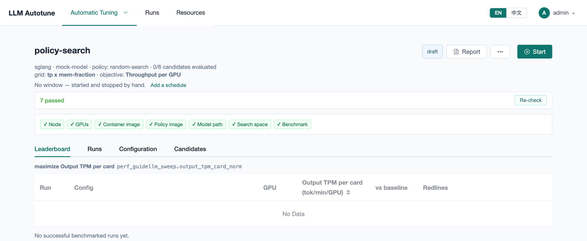
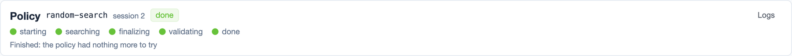
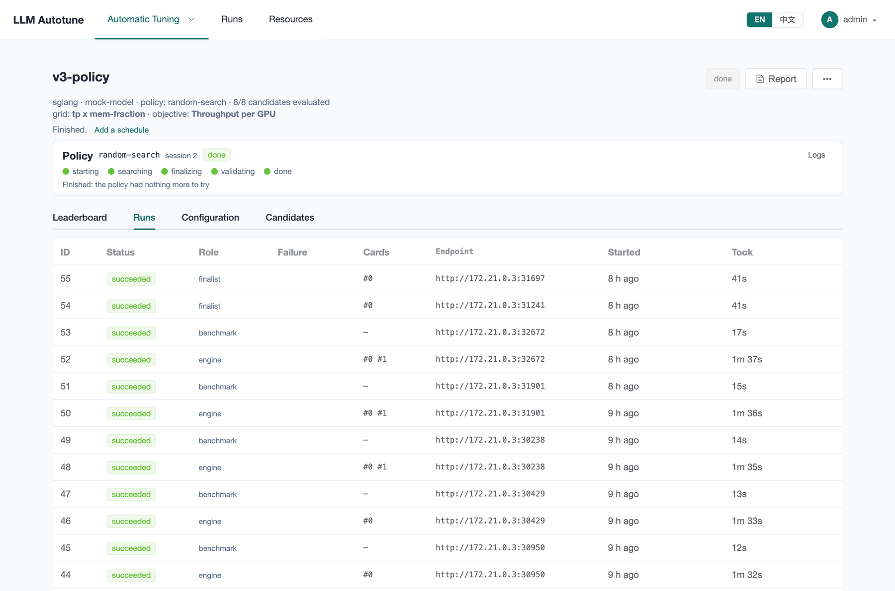
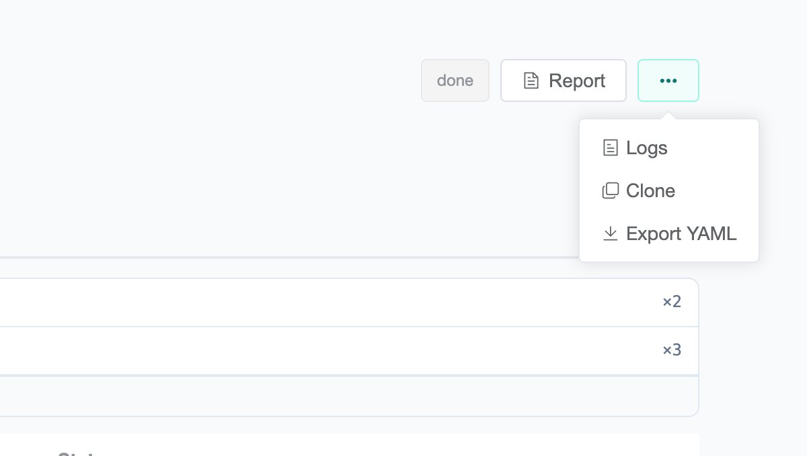

[User guide](README.md) › **Running a campaign**

# Running a campaign

Everything about one campaign is on its page: open it from
**Automatic Tuning ▸ Campaigns**. This page covers starting, pausing and
stopping it, its schedule, and what the page tells you while it runs. Reading
the results is [the next page](results.md).

## The campaign page

- **The heading** names the engine, the model, how it searches (*every
  configuration, in order*, or the policy), how many candidates have been
  measured so far, the search space and the objective.
- **The status tag** and, next to it, **Report**, **⋯** (Logs, Clone, Export
  YAML) and the run controls.
- **The schedule line** says when the campaign runs next, or until when it
  runs now. **Edit schedule** or **Add a schedule** changes it.
- **The policy panel** appears for a policy campaign
  ([below](#a-policy-campaign)).
- **The tabs**: Leaderboard, Runs, Configuration and Candidates
  ([Reading results](results.md)).

## Statuses

| status | means |
|---|---|
| **draft** | Created, never started, and no window. Press **Start**. |
| **scheduled** | Waiting for its window; it starts by itself when the window opens. |
| **active** | Running: using machine time inside its window, or since you started it. |
| **paused** | Held by a person. The schedule does not restart it. |
| **done** | Every candidate measured, or the schedule has no nights left. |

*Scheduled* and *paused* both mean "not running now", on purpose: one waits for
the clock, the other for a person. A paused campaign never restarts at 23:00
on its own.

## The run controls

The buttons on the right change with the status:

| status | buttons |
|---|---|
| draft | **Start** |
| scheduled | **Run now**, **Pause** |
| active | **Pause**, **Stop** |
| paused, with a window | **Run now**, **Resume schedule** |
| paused, no window | **Start** |
| done | none; **Report** and **Re-run failed configs** remain |

- **Start** sets a campaign going now. It runs until its search is done or you
  stop it.
- **Run now** starts a scheduled campaign at once, outside its window. It runs
  until its search is done or you stop it, then goes back to its schedule.
- **Pause** starts nothing new. Runs already going finish, and their results
  count.
- **Stop** ends the runs in progress at once and pauses the campaign. Their
  measurements are lost, and those configs are queued again: the next
  **Start** measures them. For a policy that is still searching, the first
  **Stop** asks it to wrap up: it names its finalists and the platform
  measures them. Press **Stop** again to end it at once.
- **Resume schedule** hands a paused campaign back to its window.

**Re-run *N* failed configs** appears when some candidates failed on every
attempt (or you stopped their run on the **Runs** tab). It queues them again
and puts the campaign back to work, after you have fixed what made them fail
(an image, a path, a machine).

## The schedule

A campaign with a window runs every night between **Start** and **End**, in
its timezone. The platform plans each night: it starts nothing that could not
finish before the window closes, based on how long this campaign's runs have
taken so far, and stops its own runs at the end. A search too big for one night
continues the next night where it stopped. **Repeat until** ends the schedule
on a date.

The schedule line reads, for example:

- *nightly 23:00–08:00 Asia/Shanghai (overnight). Next window in 9 hours*;
- *… Awake now until Oct 12, 08:00*, inside a window;
- *Started outside its window: runs until the search is done or you stop it,
  then back to nightly 23:00–08:00*, after **Run now**;
- *No window — running until the search is done or you stop it*, or *started
  and stopped by hand* when it is not running;
- *… — finished*, once it is done.

**Edit schedule** changes the window of an existing campaign; **Add a schedule**
gives one to a campaign that has none.

## Before it starts: pre-flight checks

While a campaign is a draft, scheduled or paused, its page offers **Run
pre-flight checks**: the same checks as the last step of New campaign, against
the machines as they are now. Run them again after changing a machine or an
image.

Banners above the tabs warn about the campaign's machines: a lease that is
ending soon, or a machine that is not available. If the campaign is active but
nothing is running, a banner says why, machine by machine, in the same words
as the machine's card on **Resources**.

## A policy campaign

A campaign with a policy shows the policy's **session** as a panel:

- **The track**: *starting* (the policy pod is being placed), *searching*,
  *finalizing* (it names its finalists), *validating* (the platform measures
  the finalists itself) and *done*.
- **The line under it**: how many trials so far, how many finalists, when the
  policy last reported, and its latest message, such as "t3: benchmarking".
  Once it is done, why the search ended, such as "the policy had nothing more
  to try".
- **Waiting on:** what a stuck policy is waiting for.
- **Logs** opens the policy container's log. **Abort** ends the session at
  once.

On the **Runs** tab, each trial of a policy usually shows as two rows, told
apart by the **Role** column: the *engine*, which stays *serving* while the
policy uses it and holds the GPUs, and the *benchmark* of it, which has the
same endpoint and no GPUs of its own. The *finalist* rows are the platform's
own measurements at the end.

## While it runs

- **Runs tab.** Each run goes *pending* → *launching* → *waiting ready* →
  *health check* → *benching* → *succeeded* (or *failed*). **Cards** says which
  GPUs of the machine it holds (`#0 #1`). **Stop** on a live row ends that one
  run. Click a row for its details and log ([Runs and failures](runs.md)).
- **Leaderboard.** Fills in as results arrive.
- **Resources.** Each machine card links to the campaigns using it, and shows
  the cards in use.
- **⋯ ▸ Logs.** The engine logs of the campaign's runs: live while a run is
  going, and the end of each log once it has finished.

## Copying a campaign

**⋯ ▸ Clone** makes a new campaign with the same definition (not the
results), under a name you give. Use it to run the same search again later,
on another machine, or with one thing changed. **⋯ ▸ Export YAML** gives the
same definition as a file, which **Import YAML** on New campaign reads.

---

← [Creating a campaign](campaigns.md) · [User guide](README.md) · Next: [Reading results](results.md) →
