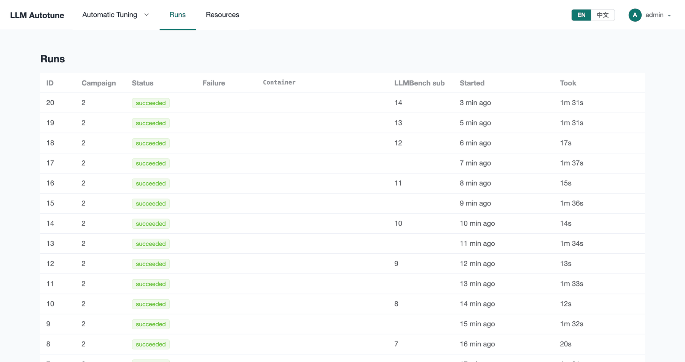
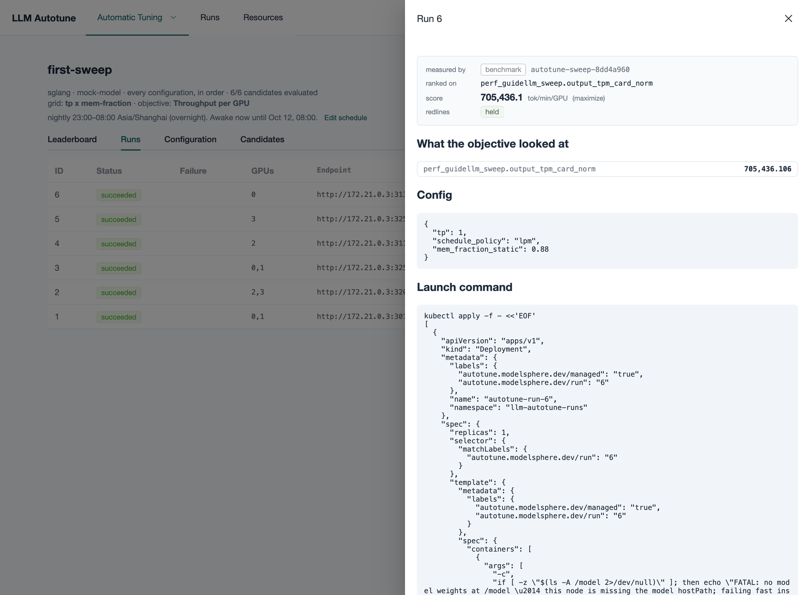

[User guide](README.md) › **Runs and failures**

# Runs and failures

A **run** is one attempt at one candidate: the engine started with that config,
checked, benchmarked and stopped. **Runs** in the top menu lists every run of
every campaign, newest first. Click a row to open its campaign; the campaign's
**Runs** tab has each run's full details.

| column | means |
|---|---|
| **Campaign** | the campaign it belongs to |
| **Status** | where it is in its life (below) |
| **Failure** | for a failed run, what kind of failure (below) |
| **Container** | the name of its container or Kubernetes workload |
| **LLMBench sub** | the id of its benchmark submission on LLMBench |
| **Started**, **Took** | when it started, and how long it took |

**Stop** on a live run ends that one run: on the worker's next pass its engine
is torn down and its GPUs released.

## A run's life

| status | what is happening |
|---|---|
| **pending** | waiting for a machine with enough free GPUs, inside the window |
| **launching** | starting the engine: on Kubernetes, creating the pod and pulling the image |
| **waiting ready** | the engine is loading the model; the platform waits until it answers |
| **health check** | a short check that it answers requests correctly |
| **benching** | LLMBench is sending the workload |
| **serving** | (policy campaigns) the engine is up and held for the policy to use |
| **succeeded** | measured; its score is on the leaderboard |
| **failed** | something went wrong; **Failure** says what kind |
| **killed** | stopped by a person, a lease ending or the window closing |

Waiting for the model to load usually takes longest. A run that never becomes
ready within the campaign's limit fails as `ready_timeout`.

## Kinds of failure

Some failures are the config's fault: run it again and it fails again. Others
are the machine's, the network's or the registry's. The platform treats them
differently:

- **The config's fault.** Recorded as the config's result. A policy learns to
  avoid that region; the config is not retried.
- **The infrastructure's fault.** Not held against the config. The candidate is
  tried again on a fresh placement, up to three attempts.

| failure | whose fault | usually means |
|---|---|---|
| `oom` | config | out of GPU memory: lower `mem_fraction_static` or `max_running_requests`, or use more GPUs |
| `bad_config` | config | the engine refused a flag or value (`unrecognized arguments`, `invalid argument`) |
| `model_load` | config | the weights could not be loaded: wrong path, or not a model the engine supports |
| `ready_timeout` | config | the engine never became ready in time |
| `nccl` | config | GPUs could not talk to each other (multi-GPU or multi-node) |
| `segfault` | config | the engine crashed |
| `benchmark_not_passed` | config | the benchmark ran but the engine failed it |
| `image_missing`, `image_pull` | infrastructure | the image name or tag is wrong, or the nodes can't reach the registry |
| `mount_failed` | infrastructure | the model path does not exist on that node |
| `unschedulable` | infrastructure | no node has the free GPUs right now. Not really a failure: the run waits. |
| `unplaceable` | infrastructure | no node could *ever* take it, such as more GPUs than any node has |
| `port_conflict`, `gpu_busy` | infrastructure | something else held the port or a GPU at launch |
| `ssh_timeout` | infrastructure | an ssh machine did not answer |
| `killed_externally`, `gone`, `orphaned` | infrastructure | the container disappeared from under the platform |
| `health_check` | neither | it came up but answered wrongly |
| `bench_preflight` | neither | LLMBench could not reach the engine's endpoint |
| `terminated`, `released` | neither | stopped on purpose: a stop, a pause, the window closing |
| `unknown` | neither | the log matched nothing known; read it |

## Finding out why

Open the run on its campaign's **Runs** tab:

- **Error** has the platform's own explanation.
- **Captured log** has the engine's output, ending where it failed. For a run
  still going it is the log so far. **Download** saves it.

A failure on every candidate at once is almost never the configs. It is the
image, the model path or the machines, and the campaign's
[pre-flight checks](running-campaigns.md#before-it-starts-pre-flight-checks)
usually name it. Fix it, then press **Re-run *N* failed configs** on the
campaign. More in [Troubleshooting](troubleshooting.md).

---

← [Baselines](baselines.md) · [User guide](README.md) · Next: [Account, users and API keys](account.md) →
