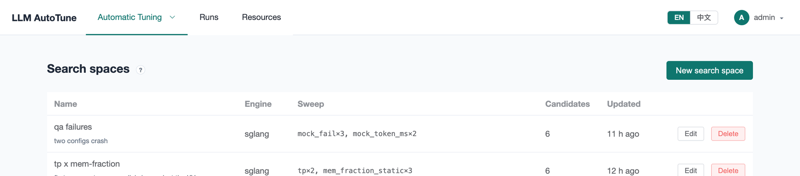
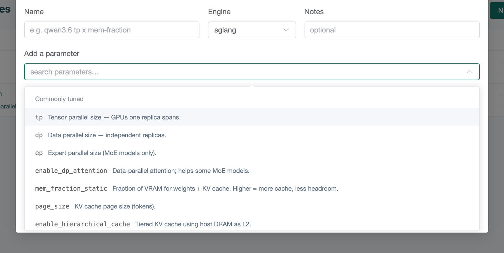
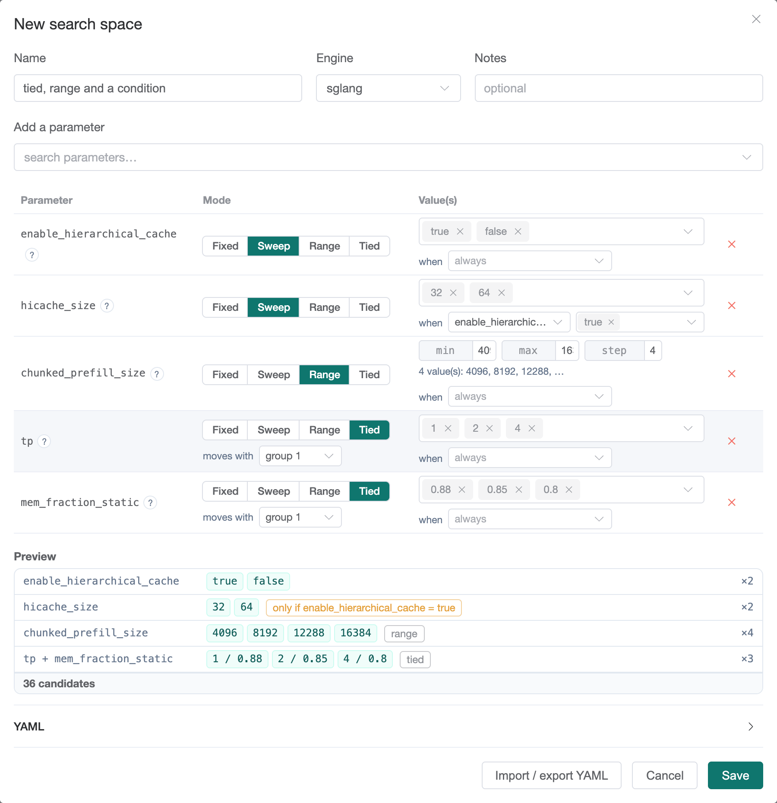

[User guide](README.md) › **Search spaces**

# Search spaces

A **search space** lists the engine settings a campaign may change and the
values each may take. Every combination is a **candidate**: one config the
campaign may launch and measure. Search spaces are under
**Automatic Tuning ▸ Search spaces**.

A campaign copies the search space when it is created, so editing a space
later does not change existing campaigns, and one space can seed many
campaigns.

## The list



**Sweep** summarizes what varies (`tp×2, mem_fraction_static×3`) and
**Candidates** gives the number of configs. **Edit** opens the editor;
**Delete** removes the space (campaigns created from it keep their copy).

## Creating a search space

Press **New search space**.

1. Enter a **Name**, select the **Engine** (`sglang` or `vllm`), and
   optionally add **Notes**.
2. **Add a parameter**: search for an engine setting. The list has two groups,
   **Commonly tuned** and **Usually fixed**, each entry with a one-line
   description. An unlisted flag can be typed in, without leading dashes and
   with underscores: `--max-total-tokens` is `max_total_tokens`.
3. For each parameter, choose its **Mode** and enter the values (below).
4. Check the **Preview**, then **Save**. Saving reports any parameter left
   without a value.



The **?** next to each parameter in the table repeats its description.

## Modes



**Fixed.** One value on every candidate, for a setting that should be set
but not searched, such as `schedule_policy: lpm`.

**Sweep.** A list of values to try. Type a value and press Enter, or paste
several separated by commas. Parameters with a fixed set of choices
(`schedule_policy`, `kv_cache_dtype`…) offer them in a list. Swept parameters
multiply: 2 values of one and 3 of another make 6 candidates.

**Range.** Every value from **min** to **max** in increments of **step**: min
4096, max 16384, step 4096 tries 4096, 8192, 12288 and 16384. A policy can
treat a range as an interval rather than a list.

**Tied.** Parameters that only make sense together change together instead of
being multiplied. Give each tied parameter the same **group** and list its
values in the same order: the first values form one candidate, the second
values the next, and so on. Above, `tp` and `mem_fraction_static` in group 1
make three candidates (`1 / 0.88`, `2 / 0.85`, `4 / 0.8`), not nine: a memory
fraction that is safe at `tp=4` may run out of memory at `tp=1`. If the lists
differ in length, the extra values are dropped and the editor warns.

## Conditions: "when"

Some settings only take effect when another is enabled: `hicache_size` has no
effect unless `enable_hierarchical_cache` is `true`. Set **when** on such a
parameter to the parameter it depends on, and **is…** to the values that
enable it. Candidates where it would have no effect omit it, so the same
config is not launched twice. The preview marks it *only if …* and counts only
distinct candidates: above, 2 × 2 × 4 × 3 would be 48, but only 36 differ.

## The preview

The **Preview** under the table shows each parameter's values and the number
of candidates. Each candidate is one engine run, with model loading and a
benchmark, so the count determines the cost. A few dozen candidates suit a
grid search; for more, use a [policy](policies.md).

The preview also checks every candidate against the largest machine:
a `tp` × `dp` that needs more GPUs than the machine has, a memory fraction
outside 0.1–0.99, or a parallel layout the engine refuses to start with (such
as `ep` larger than the GPUs the config runs on). Such candidates are
listed under *rejected by static validation* and never launched.

## YAML

**Import / export YAML** shows the space as text and imports one, for keeping
spaces in a repository or copying them between installs. The format:

```yaml
name: tp x mem-fraction
engine: sglang
description: first sweep
base:                                   # Fixed
  schedule_policy: lpm
grid:                                   # Sweep
  mem_fraction_static: [0.8, 0.85, 0.88]
range:                                  # Range
  chunked_prefill_size: {min: 4096, max: 16384, step: 4096}
tied:                                   # Tied, one entry per group
  - tp: [1, 2, 4]
    max_running_requests: [64, 128, 256]
conditions:                             # when
  hicache_size: {enable_hierarchical_cache: [true]}
```

## Recommendations

- **Start from production.** Fix what production sets and sweep one or two
  settings around it. A [baseline](baselines.md) can draft the whole campaign
  (**Tune from this**).
- **Two or three values per parameter** are usually enough to find the
  direction; narrow in with a second campaign.
- **Tie settings that depend on each other** instead of multiplying them.
- **GPU count:** a candidate with `tp=4` needs a machine with 4 free GPUs. With
  **Parallel candidates** on, a machine runs several narrow candidates at
  once.

---

← [Machines and GPU clusters](machines.md) · [User guide](README.md) · Next: [Objectives](objectives.md) →
