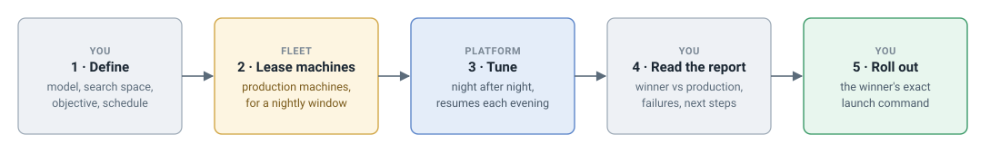

# How it works

The product view, without code. For the engineering view, see
[Architecture](architecture.md).

## Problem

LLM serving performance depends on many engine settings: how many GPUs one
model replica spans, how much memory it reserves, which scheduler and decoding
options are enabled. The best values differ per model and GPU type, the
settings interact, and the only reliable way to compare them is to measure
them. LLM AutoTune runs those measurements on real GPUs, the same way for
every config, and ranks the results against the configuration production
runs today.

## Campaign lifecycle



1. **Define** the model and engine, the **search space** (the settings and
   values to try), the **objective** (one metric to improve, plus **redlines**
   such as a latency limit that a config must hold), and a schedule.
2. **Lease machines.** Production machines are leased to the platform for a
   nightly window, or a Kubernetes cluster provides idle GPUs.
3. **Tune.** A **policy**, the search algorithm, picks configs; the platform
   runs and measures them. A large search spans several nights and resumes
   where it stopped.
4. **Read the report** after each window.
5. **Deploy** the winner using its engine command and image.

## A tuning window


The machine is leased with nothing else running on its GPUs. The platform
first measures production's config as the **baseline**. The policy searches
until the deadline; the platform then re-measures the policy's best configs
itself, stops its own runs, and returns the machine. No run starts unless it
can finish inside the window, and a measurement that decides the result runs
alone on its machine.

## Evaluation stages


Cheap checks run first, so expensive benchmarks are spent only on configs that
can win. A failed config is recorded with its cause (crash, out of memory,
wrong answers, crossed redline), and the policy receives it as a result.

## Replay datasets

The most representative benchmark replays production traffic, which changes
over time. The replay dataset is therefore **fresh across campaigns** (a new
campaign can rebuild it from recent traffic) and **frozen within one** (every
config in a campaign receives the same requests). Each result records its
dataset, so results from different datasets are never compared.

## The report

Each campaign produces a Markdown report:

```markdown
# qwen3-8b-tp-sweep

- **Objective**: maximize `output_tps`
- **Model**: `/models/Qwen3-8B` on `sglang` (`lmsysorg/sglang:v0.5.4`)
- **Runs**: 14 succeeded, 2 failed, 1 baseline

## Verdict

**mem_fraction_static=0.9, tp=2** beats production by **+12.0%** (6,858.7 vs 6,124.0), on a single measurement

## Results

| Config | output_tps | vs production | Runs |
|---|---|---|---|
| production (as handed over) | 6,124.0 | — | 41 |
| mem_fraction_static=0.9, tp=2 | 6,858.7 | +12.0% | 47 |
| mem_fraction_static=0.85, tp=2 | 6,840.6 | +11.7% | 45 |

## Ran, but crossed one of the objective's redlines
## Failures
## Suggested next steps
```

The report does not claim a win the data does not support: a lead within the
noise threshold is reported as **no meaningful difference**, and repeated
measurements that disagree by more than the lead are reported as **unstable**.

## Guarantees

- **Production workloads are not affected.** The platform runs only on
  machines leased to it, and stops only what it launched.
- **The platform measures.** Every config is benchmarked the same way, and a
  policy's own numbers never decide the result.
- **Results are comparable.** One frozen dataset per campaign, production
  measured the same way, and the dataset recorded on every result.
- **Everything is recorded.** Settings, versions, the exact launch command,
  results and failure causes, enough to reproduce any run.
